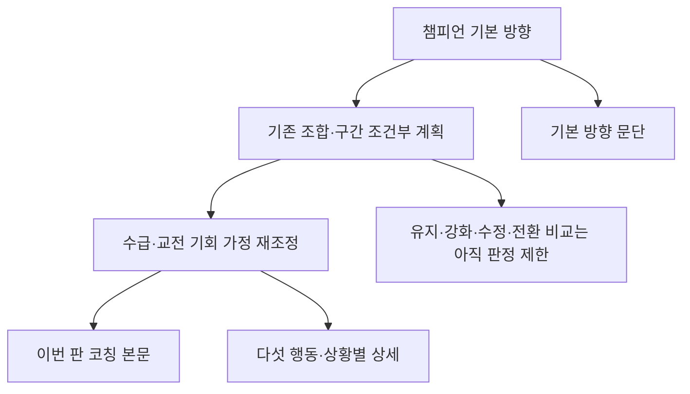

# 챔피언 기본 방향과 이번 판 계획 — 첫 구현 범위

v0.4 명세 GP-0.6.1~6 / GP-0.8 / GP-3.7의 일부를 기존 v1.3 생성기에 연결했다. 전체 명세 구현 완료나 상성 판단 정확도 검증을 뜻하지 않는다.

| 계층 | 이번 구현 | 남은 확장 |
|---|---|---|
| 챔피언 기본 방향 | 케이틀린·이즈리얼 바텀, 라인전·운영·한타별 목적·방법·근거 | 다른 챔피언/역할, 대안·실패 조건의 구조화 |
| 아군·상대에 따른 변화 | 기존 생성기의 압박·대응과 연결. 조합 자체의 우열로 승격하지 않음 | 연계·방해·실패 비용을 주장별로 비교하고 변화 분류 |
| 경기 조건 | 기존 수급·기회 재조정 전 계획과 최종 실행을 별도 기록 | 운영·한타의 필요성/가능성 비교 확장 |
| 코칭 본문 | 기본 방향을 독립 문단으로 기본 노출, 기존 상황 전개가 이어짐 | 조건 활성화에 따른 설명량 조절과 중복 축약 |

## 데이터 계약

`direction_hierarchy[phase]`는 `baseline`, `composition`, `execution`, `state_adjustment`, `change`, `coverage`를 가진다.

- `baseline`은 버전이 있는 작성된 전략 해석이다. 공식 스킬 근거는 작동 기전만 지지하며 라인전 우위·선푸시 가능성을 입증하지 않는다.
- `composition`은 기존 구간·자원 가정을 포함한 계획의 스냅샷이다. **모든 경기 조건을 제거한 순수 조합 판정이 아니다.** `SCENARIO_PLAN_BEFORE_WAITING_RECONCILIATION`으로 표시한다.
- `execution`은 수급·기회 가정까지 반영한 최종 기존 결정과 연결한다.
- `change.kind=LIMITED`: 유지/강화/부분 수정/전환을 자동 분류하는 규칙은 이 변경에 없다.
- 상세 조합을 지원하지 않으면 `BASELINE_ONLY` 및 `composition=null`. 블리츠크랭크라는 이름만 보고 압박 가능/불가능을 발명하지 않는다.
- 패치 불일치, 필요한 기본 스킬 근거 누락, 다른 포지션에는 새 프로필을 붙이지 않는다. 다른 포지션의 기존 작성 계획은 유지한다.

## 수정한 부분

- 콘텐츠·생성: `web_r4/loading-planboard.js`. 단계별 기본 프로필, 기존 계획/상태 연결, 본문 첫 문단.
- 화면: 새 UI 판단이나 별도 요약을 만들지 않았다. 기존 코칭 문단 투영 경로로 기본 노출한다. CSS는 그대로다.
- 검증: `tests_pregame/test_gameplan_direction.py` 및 기존 source-bound CI에 신규 테스트 등록.
- 실제 생성 결과: `evidence/actual-evidence/gameplan-direction-20261024/generated.json` (세 조합의 입력·다섯 행동·본문·계층).

## 검증 상태

- 신규 3개 계약 테스트는 기능이 없는 상태에서 실패 확인 후 구현했다.
- 신규/기존 코칭·플랜보드·화면 투영 52개 테스트 통과.
- 독립 코드 리뷰 후 조합 계획과 최종 상태 행동의 중복 저장을 수정하고 회귀 검증했다.
- 로컬 Chromium 실행 파일이 없고 다운로드 아카이브가 손상되어 실제 모바일 렌더링은 아직 확인하지 못했다. 기존 CI 브라우저 검증 결과를 기다린다. 스크린샷이나 실전 효과를 검증한 것으로 보고하지 않는다.
- 공개 사이트 배포 상태는 PR/CI와 별도이며 이 문서는 배포 완료 증거가 아니다.
