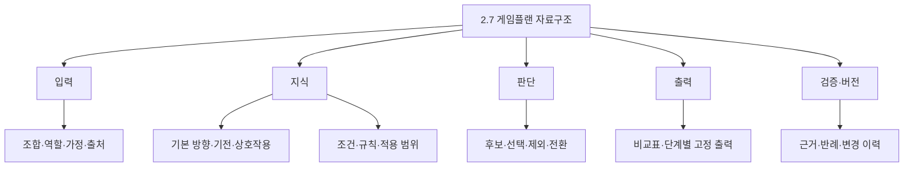

# LoL Coach 2. 게임플랜 — 계층·백엔드 설계 v1.0

기준일: 2026-10-24 KST. 사용자와 이 채팅방에서 합의한 제품 기준을 정리한다.
이 문서는 전체 기능의 구현 완료 보고가 아니다. 마지막의 실제 구현 범위를 별도로 확인한다.

## 1. 제품 경계

게임플랜은 검토된 지식과 규칙으로 재현 가능한 계획을 생성한다. AI의 자유 추론을 모방하는 것을 목표로 삼지 않는다. 같은 입력·가정·자료·규칙·표현 버전은 같은 결과를 생성해야 한다.
엔진 수와 정보량이 늘어도 사용자 출력 형식은 늘어나지 않는다. 자세한 내부 판단 기록은 사용자 코칭 본문과 분리한다.
기존 구현은 재사용 자산이며, 이 채팅방에서 정한 요구와 충돌하면 최신 사용자 요구를 우선한다.

## 2. 기능 계층과 책임

2.1~2.7은 제품 계층이다. 하위 항목은 새로운 화면을 뜻하지 않는다. 각 항목에 내부 처리 / 전달 계약 / 화면 표현을 표시한다.
백엔드는 논리적 책임이다. 서버 배치나 신규 서버 설치를 뜻하지 않으며 현재 JavaScript 생성 경로를 재사용한다.

| 번호 | 제품 기능 | 내부 처리 | 전달·화면 |
|---|---|---|---|
| 2.1 | 입력·연결 | 조합·역할·사용자 정규화, 누락·충돌·출처 관리 | 수동 수정·연결 상태 |
| 2.2 | 전체 조합 방향 | 양측 목적·상대 방해·공동 작전·개인 역할 | 정해진 비교표·역할 코멘트 |
| 2.3 | 라인전·초반 정글 | 기본 방향·조합 변화·수급·웨이브/동선·교환·복구 | 한줄평·다섯 행동·본문·상세 |
| 2.4 | 운영 | 배치·지원·압박·합류·대안·상대 대응 | 같은 고정 형식 |
| 2.5 | 한타 | 위치·호응·대상·기술 교환·지속·철수 | 같은 고정 형식 |
| 2.6 | 조건 변경·비교 | 가정 적용·영향 재판정·초기화 | 같은 출력 틀에서 갱신 |
| 2.7 | 자료구조 트리 | 지식·규칙·판단·출력·근거의 탐색과 변경 영향 | 조회·편집 UI는 별도 미구현 |

2.1은 향후 실제 이용 가능한 롤 API/클라이언트 연결을 통해 경기 진입 시 조합을 자동 공급한다. 수동 입력과 같은 내부 계약을 사용한다. 구체적인 연결 수단·제공 시점·필드·권한은 연동 시 확인한다. 조합 자동 입력은 체력·웨이브·위치 관측을 의미하지 않는다.
모바일·접근성·로딩·오류 표시는 2.7의 하위 지식이 아니라 공통 품질 요건이다.

## 3. 고정 출력 계약

- 전체 조합: 비교표 + 사용자 역할 코멘트.
- 세 단계: 한줄평 → 역할이 정해진 다섯 행동 → 코칭 문단 → 선택적 상세.
- 정글은 라인전 자리를 초반 정글로 바꾸며 새 상위 카드를 만들지 않는다.
- 조건 변경은 동일한 틀을 갱신한다.
- 정보가 늘어도 표 행·카드·행동 수를 임의로 늘리지 않는다.
- 문단은 판단 변화에 필요한 만큼만 구성한다. 상세도 사용하지 않은 자료를 전부 덤프하는 곳이 아니다.
- 출력 단계가 새 전술·관측·수치를 만들지 않는다. 중요한 제한을 잘라내면서 형식을 맞추지 않는다.
- 다섯 행동의 수가 잘못되면 조용히 잘라내거나 문장을 만들어 채우지 않고 계약 오류를 남긴다.

### 3.1 기존 코드와의 차이

현재 loading-planboard.js는 판단·본문·자료 일부를 함께 갖고 있고 loading-presentation.js가 필드를 직접 읽는다.
이번 변경은 최종 결과에서 세 단계용 delivery를 한 번 구성하고 화면이 그 결과를 우선 소비하도록 한다. 옛 보고서는 기존 투영 경로로 읽는다.
전체 조합 비교표의 기존 투영은 4개 행이며 GP 명세의 5개 판단 행과 차이가 있다. 이번에 임의 행을 추가하거나 기존 화면을 바꾸지 않는다. 비교표 내용 대응은 별도 구현 과제로 남긴다.

## 4. 내부 상세기능 정의 규칙

각 기능은 소속 / 사용자 질문 / 입력 / 판단 / 출력 연결 / 전환 조건 / 반례 / 완료 기준을 가진다.
챔피언·규칙 추가는 관련 기능의 지원 범위를 넓히며 새 기능 번호를 자동 생성하지 않는다.

| 영역 | 내부 처리 묶음 | 출력 연결 | 필수 반례 |
|---|---|---|---|
| 2.2 | 양측 목적, 주·보조 작전, 역할 충돌, 실패 조건 | 비교표·역할 코멘트 | 같은 팀 사용자 변경 시 공동 전략 유지 |
| 2.3 | 기본 방향, 아군 결합, 상대 방해, 웨이브/교환 후보, 비전투 손실, 복구 | 다섯 행동·본문 | 교전이 필요해도 실행 불가면 여건 변경 |
| 2.4 | 현재 배치, 여섯 작전 후보, 지원, 상대 반응, 중단 | 다섯 행동·본문 | 상대를 불렀어도 다른 이득이 없으면 성공 단정 금지 |
| 2.5 | 시작 위치, 참여, 대상, 대응 수단, 재진입·철수 | 다섯 행동·본문 | 아군 CC 적중이 사용자 호응을 보장하지 않음 |
| 2.6 | 픽 교체, 사용자 관점, 가정 변경, 관련 결과 갱신 | 동일 출력 틀 | 초기화 시 같은 버전 기본 결과 복원 |

운영 여섯 후보: 선푸시 후 합류, 선푸시 후 포탑 압박, 웨이브 유지, 받아먹고 재정비, 일부 수급 포기 후 합류, 반대편 교환.
현재 기능 번호를 재배치하거나 재사용하지 않는다. 새로운 세부 번호는 기존 GP 계약과 대응표를 만든 뒤 등록한다.

## 5. 조건·규칙·판단 계약

조건 결과는 충족 / 불충족 / 미확인이다. 미확인을 Boolean(참·거짓) 기본값으로 변환하지 않는다.
모두 조건: 불충족이 하나라도 있으면 불충족, 모두 충족이면 충족, 나머지는 미확인.
하나 이상 조건: 충족이 하나라도 있으면 충족, 모두 불충족이면 불충족, 나머지는 미확인.
부정 조건: 충족과 불충족만 뒤집고 미확인은 유지한다.
빈 묶음·잘못된 연산·잘못된 값은 잘못된 규칙으로 거부한다. 명시적인 조건 없음은 별도 상수 true/false로 작성한다.

향후 규칙 레코드: ID·버전·적용 단계·관련 인원·필수 조건·제외 조건·판단 영향·근거·충돌·대체·채택 상태·반례.
조건 레코드: 대상·시점·범위·기전/관측/가정 구분·출처. 미확인과 입력 충돌은 구분해서 기록하되 판정값은 미확인으로 처리한다.
기본 방향 → 후보 생성 → 필수 조건 검사 → 상대 대응·비용 비교 → 기본안/복수안/판단 제한 → 설명 구성 순서다.
ID 정렬은 재현을 위한 것으로 전술 우선순위가 아니다. 임의 가중 점수로 정답을 고르지 않는다.
아군·상대 개별 관계의 합이 전체 조합 판단을 증명하지 않는다.

## 6. 2.7 자료구조 트리

트리는 탐색 관점이며 실제 관계는 ID 참조다. 동일 스킬·규칙을 여러 가지에 복사하지 않는다.
단계별 기본 방향: 챔피언·역할·단계·목적·주/보조 수단·성립 조건·실패 조건·대체 기여·근거.
판단 결과: 입력/규칙 버전·비교 범위·적용/제외 규칙·후보·선택 이유·전환·지원 한계·출력 연결.
표현 자료: 주장 ID·필수 전제·문단 연결·출력 위치. 내부 진단 필드는 사용자 본문으로 자동 노출하지 않는다.

### 6.1 패치 접근성과 영향 추적

자료 수정 → 의존 규칙 → 판단 → 출력 위치 → 동일 사례 변경 전후 비교.
기존 원문·승인 이력·과거 출력은 보존하고 새 버전을 만든다. 되돌리기는 이전 버전 선택으로 처리한다.
이번 구현은 보고서 내부의 기본 방향·서술 판단에 연결된 근거와 출력 위치를 추적하는 부분 인덱스다. 전체 저장소 규칙의 완전한 의존 그래프가 아니다. 목록에 없다는 이유로 패치 영향이 없다고 판정하지 않는다.
편집 UI, 자동 패치 수집, 규칙 저장소 전체 재검증·롤백 운영은 후속 작업이다.

## 7. 다른 챔피언 확장

공통 조건 처리 + 챔피언 고유 지식 + 검토된 상호작용을 조합한다.
등록 여부, 기본 방향 지원, 구체적 조합 지원, 전술 검증을 따로 관리한다.
확장 순서: 케이틀린·이즈리얼 대표 사례 → 카이사/직스의 비전투 손실 → 피오라/그레이브즈/자르반/오리아나 및 서포터 → 포지션별 다른 기전 → 다대다 → 전체 미지원 범위.
같은 결론이 맞으면 유지하고 실행 방법·비용 차이를 설명한다. 이름만 치환하거나 억지로 결론을 바꾸지 않는다.

## 8. 구현 선택과 순서

선택: 기존 JavaScript 생성기에 순수 함수 형태의 계약을 추가한다. 서버 전면 교체는 현재 필요하지 않고 대규모 파일 분리는 테스트 근거 없이 진행하지 않는다.
1. 세 값 조건 처리와 기존 기본 방향 적용 조건 연결.
2. 최종 판단에서 세 단계 delivery 생성, 화면은 이를 우선 소비.
3. 보고서 내 근거→기본 방향/판단→출력의 부분 추적 트리와 변경 영향 조회.
4. 대표·미지원·가정 변경·출력 재현·기존 화면 투영 회귀 검사.
5. 이후 규칙 데이터 분리·채택/충돌·후보 비교·조합 변화 분류·전 포지션 확장.

## 9. 완료 판정과 한계

소프트웨어 계약 검사 / 콘텐츠 검토 / 전술 정확도 / 화면 검증 / 실전 효과를 분리한다.
현재 문서는 설계 기준이다. 실행 결과는 별도 결과 절에 기록한다.
PR130은 인수 시 OPEN/DRAFT, HEAD f514ab1. 이 변경은 별도 work/gameplan-backend-contract-20261024 브랜치에서 진행하며 병합·배포 완료를 뜻하지 않는다.

## 10. 이번 실행 결과

구현: 세 값 조건 함수, 기존 기본 방향의 사실 존재 조건 연결, 세 단계 delivery 출력 계약, 새 보고서의 delivery 우선 화면 투영, 구버전 투영 보존, 보고서 내부 부분 의존 트리와 영향 출력 조회.
계약 검사: 세 단계/각 다섯 행동, 행동 텍스트·본문 문자열 배열·상세 trigger/action 검사, 잘못된 조건/빈 묶음/희소 배열 거부. 전달 결과는 내부 필드의 후속 변경과 분리된 복사본이다. 새 입력은 재분석해 새 전달 결과를 생성한다.
검증: 신규 4개 테스트의 구현 전 실패 확인. 관련 57개 검사 최종 통과. 전체 tests_pregame 794개 검사 중 3개 실패. 동일 3개는 변경 전 main d00c255에서도 재현했다.
기존 실패: test_pc_coach의 test_source_backed_held_advice_is_explicit_hypothesis, test_source_integrity_failure_is_not_even_shown_as_hypothesis; test_v23_binding의 test_exact_delta_reuses_prior_ci_without_running_predecessor.
전체 검사 부수효과로 변경된 공식 아이템 current/refresh 파일은 원래대로 복원했다. 자료 수집 변경은 이번 변경에 포함하지 않는다.
독립 리뷰: 잘못된 조건의 희소 배열 허용, 출력 값의 타입 검사 부족을 재현 테스트 후 수정했다. 화면 출처 경로도 delivery로 수정했다.
자료·사용자 결정 보호 검사는 통과했다. 실제 브라우저 검사·원격 CI·병합·배포·실전 효과는 이번 실행의 완료 범위가 아니다.

### 후속 구현 순서
1. 기본 방향 자료를 버전별 데이터로 분리하고 수정 위치를 트리에 연결.
2. 조건에 대상·시점·출처를 연결하고 입력 충돌 처리.
3. 규칙 채택·적용·제외·충돌 기록.
4. 후보 생성·비교·기본안/대안/판단 제한.
5. 유지·강화·부분 수정·전환 분류.
6. 라인전→운영→한타와 다섯 포지션의 실제 콘텐츠 확대.
7. 전체 비교표의 기존 4행과 목표 판단 5행 대응 확정·구현.
8. 전체 규칙의 패치 의존 인덱스·버전 재현·편집 접근성.

최초 연결은 완료했으나 전체 백엔드나 모든 챔피언 조합 지원을 완료한 것은 아니다.

## 11. 기본 방향 데이터 분리 — 2026-10-24 후속

`web_r4/loading-direction-profiles.js`를 수정 위치로 분리했다. 브라우저와 Node가 같은 자료를 사용한다. 현재 범위는 BOTTOM의 케이틀린·이즈리얼, 각 세 단계다. 자료에 다른 포지션을 추가하는 것만으로 지원이 활성화되지는 않는다.

자료 계약은 `schema_version`, `version`, `source_patch`, `review_state`, `champions`다. 챔피언 항목에는 역할·필수 스킬 슬롯·단계별 근거 슬롯·목적·수단·본문 템플릿이 들어간다. `{Q}` 같은 자리표시는 해당 단계의 근거 슬롯에 포함될 때만 한국어 스킬명과 키로 치환한다. 코드 실행 또는 임의 표현식은 허용하지 않는다.

`resolveDirectionProfiles`는 전체 자료의 필수 구조를 검사하고, 잘못된 자료는 `INVALID_DIRECTION_DATA`로 거부한다. 미지원 챔피언/역할, 자료 패치 불일치, 스킬 근거 누락은 기본 방향을 추가하지 않는다. 현재 자료 패치는 16.20.1이며 최신 패치라는 주장은 아니다. 다른 패치에서 쓰려면 기전과 템플릿을 재검토하고 자료 버전·패치를 갱신한다. 자동 이월은 하지 않는다.

반환 자료는 복사본이다. 기본 방향과 내부 의존 노드에 자료 버전 및 `source_path`를 남겨 수정 파일을 찾을 수 있다. 출력 계약에는 내부 추적 메타데이터를 추가하지 않는다.

패치 수정 절차: 자료 원문·기전 변경 확인 → 프로필/근거 슬롯/템플릿 수정 → version 증가 → 동일 입력 결과 비교 → 반례·계약 검사 → source-bound seal 갱신 → PR 검토. 사용자 전술 승인 이력은 자동으로 생성하지 않는다. 과거 버전은 git 이력에 보존하며 실행 시 과거 버전 선택 기능은 아직 없다.

브라우저 두 진입 HTML, PC 서버 정적 경로, 정적 사이트 내보내기 목록, 브라우저 증거 소스 목록에 자료 파일을 연결했다. 초기 리뷰에서 발견한 서버/내보내기 누락은 HTTP 401 실패를 재현한 뒤 수정했다.

검증: 신규 자료 검증·브라우저 모듈 검사 2개를 구현 전 실패 확인 후 통과. 관련 32개 검사 통과. 두 챔피언의 변경 전후 delivery 전체 동일성 확인. PC HTTP·정적 내보내기·해시·증거 목록 포함 5개 검사 통과. 실제 브라우저 화면·배포·실전 효과는 별도다.

노션 문서 형식과 관리 기준은 `docs/gameplan-content/notion-format-v1.md`를 따른다.

## 2026-10-24 조건 범위·적용 기록 후속

- `evaluateScopedCondition(condition, scope)`: 조건 ID, boolean/null 값, 대상(subject), 단계(phase), 입력 스냅샷(snapshot), 출처(kind/ref)를 받는다. INPUT/ASSUMPTION/KNOWLEDGE 출처만 수용한다. 출처 누락·범위 불일치는 UNKNOWN이며 실제/기대 범위와 원래 값을 함께 기록한다. snapshot은 호출자 식별자이며 자동 최신성 판정이 아니다.
- `evaluateRule(rule, scope)`: ID·version·requires·excludes. 필수 불충족 또는 제외 충족은 EXCLUDED, 남은 미확인은 CONDITIONAL, 나머지는 APPLIED. 빈 필수 목록·희소 배열·중복 조건 ID는 거부한다. 임의 점수나 충돌 우선순위는 없다.
- `internal_rule_trace`: DIRECTION_ELIGIBILITY_ONLY. 현재 기본 방향 자료의 존재·역할·자료 해석·보고서 지원 문맥을 세 단계별로 기록한다. 보고서 패치 검토 대기는 적용 제외다. 전술 채택이나 전체 규칙 추적을 의미하지 않는다. `pregame-input` 시점은 해당 보고서 내부에서만 유효하고 보고서 간 최신성 비교용이 아니다.
- 기존 delivery에는 진단을 추가하지 않는다. 규칙의 실제 관측/사용자 승인 승격 없음. 후보 비교와 전체 규칙 충돌 처리는 후속.
- 독립 리뷰: 입력 패치 불일치와 원본 조건 범위 유실을 실패 재현 후 수정.

## 2026-10-24 후보 비교·충돌 처리

`resolveCandidates(candidates, scope)`는 후보 ID, 필수/제외 조건을 가진 rule, 명시적 conflicts_with를 받는다. 각 후보는 기존 evaluateRule로 판정한다. 한쪽에서만 선언한 충돌도 양방향으로 처리하고 동일 충돌은 한 번만 기록한다. 불충족으로 제외된 후보는 충돌에 참여하지 않는다.

- 둘 다 적용 가능하면 CONFIRMED(확정 충돌), 하나 이상 조건부면 POSSIBLE(잠재 충돌).
- 충돌이 없고 적용 후보가 정확히 하나이며 조건부 경쟁자가 없으면 SELECTED(선택).
- 그 외에는 CONFLICT(충돌), UNRESOLVED(비교 미확정), NO_ELIGIBLE_CANDIDATE(적격 후보 없음)로 남긴다. 선택 ID는 null이다.
- 후보 정렬은 기록 재현성만 위한 것이며 우선순위가 아니다. 빈 목록·희소 배열·중복 후보·자기 충돌·없는 충돌 대상·중복 충돌 선언은 거부한다.

첫 실제 연결은 기존 기다리기 정책이다. 기존 source/necessity/feasibility의 우선 조건을 여섯 개의 배타적 후보로 표현했다. 내부 `internal_candidate_comparison`은 WAITING_POLICY_ONLY이며 스냅샷은 해당 보고서 내부에 한정한다. 자료 검토가 필요해 상세 처리가 생략될 때도 그 이유를 기록한다. 기존 판단 실패 시 CHECK_CONDITIONS(조건 확인)로 보류하며 선택으로 가장하지 않는다.

이 구현은 실행 자격과 충돌 비교다. 기대 이득·기다리는 손실·교전 비용을 범용으로 평가하는 최적 전술 선택기는 아니다. 새 전술 점수나 우선순위를 추가하지 않았으며 근거 부족 후보의 비교는 보류한다. 고정 출력 확장 없음. 노션 최신화는 사용자 지시로 보류.
