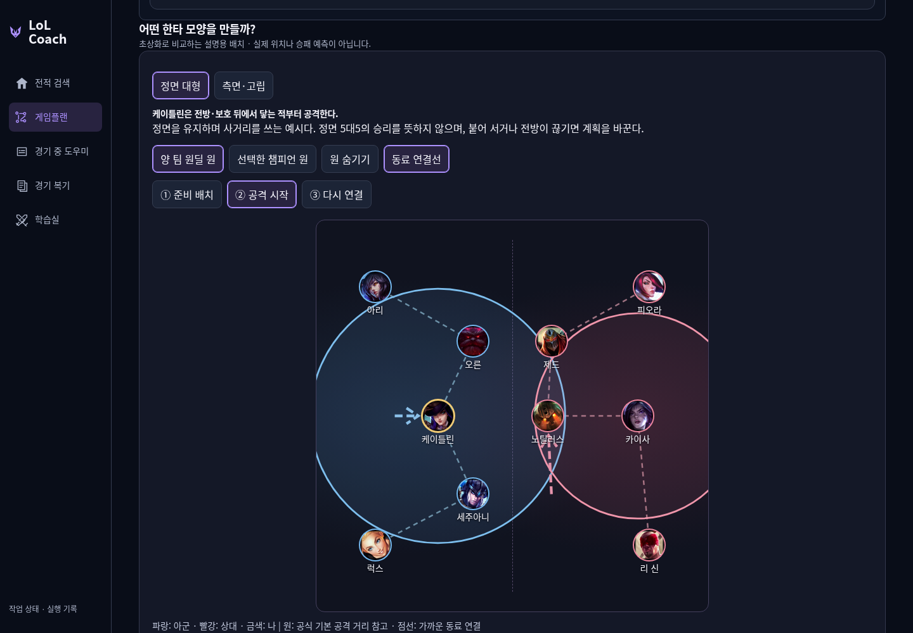
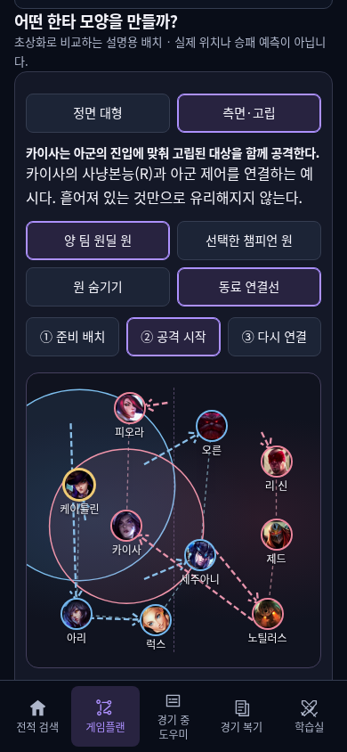
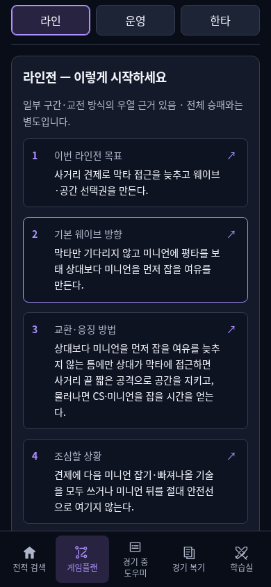
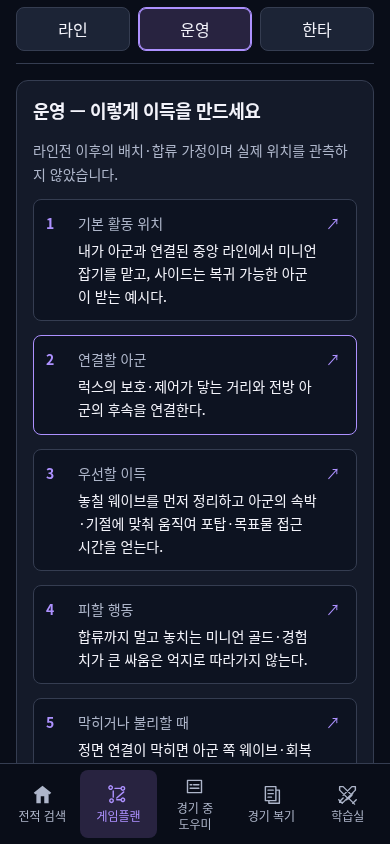
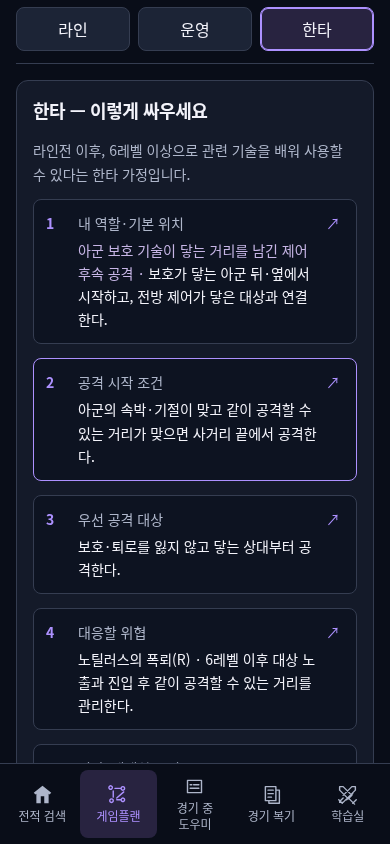

# 실제 게시 확인

- 사용 주소: https://kco994553-star.github.io/lol-coach/loading.html
- 제품 main: `89b73bda3c0ac603c66fed4ce54f8952c75a1f79`. 공개 artifact: `bdfd4503f4dcca50137b5a8d269f91c05d879dda`. PR109 required3개와 정확한 제품 main의3개 필수 검사 성공.
- native Pages `39123582704` 실제 build/deploy/report 성공. 변경 파일 HTTPS SHA256·루트·build-info·.nojekyll 확인. 기존 pro-dashboard와 riot.txt 그대로 보존.
- 실제 공개 PC1440×1000 /모바일390×844에서 첫5행·15상세 링크·정면/측면·기본 공격 원·동료 연결선·선택/단계/확대·키보드·미지원 전환·학습 공유 확인.320폭/200%가로 넘침 없음. 변형 조합 초상화 겹침 없음.
- `../report.md`에 실제 생성15문장과 A/B/C/D 처리 예시, `../generated-examples.json`에 원래 강약 판단/부족 축/출처·조건 연결을 보존했다.

## 화면

## 해석의 한계

공식 기본 공격 거리 참고와 가정 좌표이며 실제 공격 가능·합류·보호·전술적 고립의 자동 판정이 아니다. 근접/강화/아이템/기술을 합친 전체 위협 범위는 미구현. 기존 공식16.20.1 스냅샷 범위다. 원·최근접 연결은 그림의 비교이며 승패 점수나 검증된 이상 대형이 아니다.

행동 요약은 기존 결과에서 뽑은 제한적 계획이다. 미확인 올인 우열을 경합/안전/승리로 바꾸지 않는다. 인간 이해도 검증 미측정, 실전 코칭 N=0, 실제 Windows 연결 BLOCKED_EXTERNAL 유지. AUTO30/HOLD20/USER0, 조언7개·원문·보류·실패·영상 원장·무료 한도 보존. 새 provider/game/video/paid 호출0.

다음: 조건이 맞는 비교 매치업·반복 교환·성장 근거 보완. 지원되지 않은 구도/기술 사거리/실시간 위치는 임의 생성하지 않는다. 결과만 기록하는 후속 PR의 CI는 변경되지 않은 제품 검증을 재사용한다.
