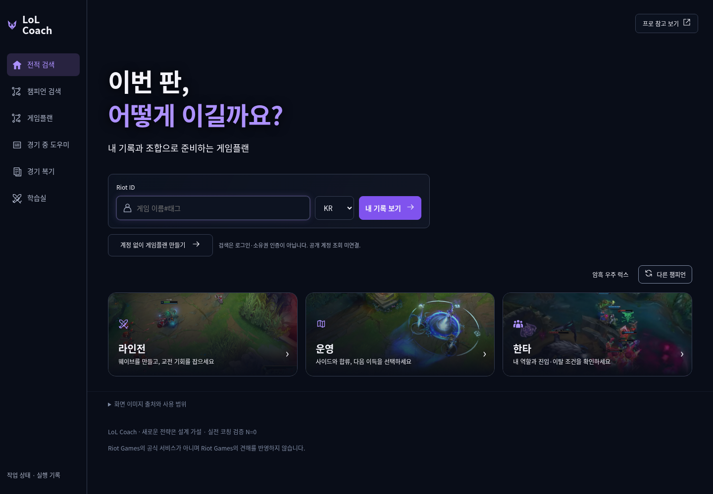
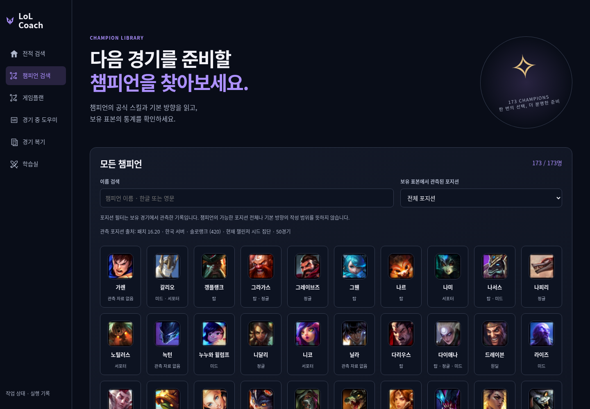
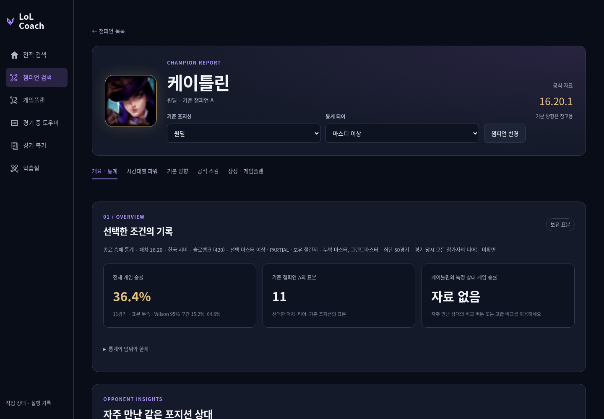
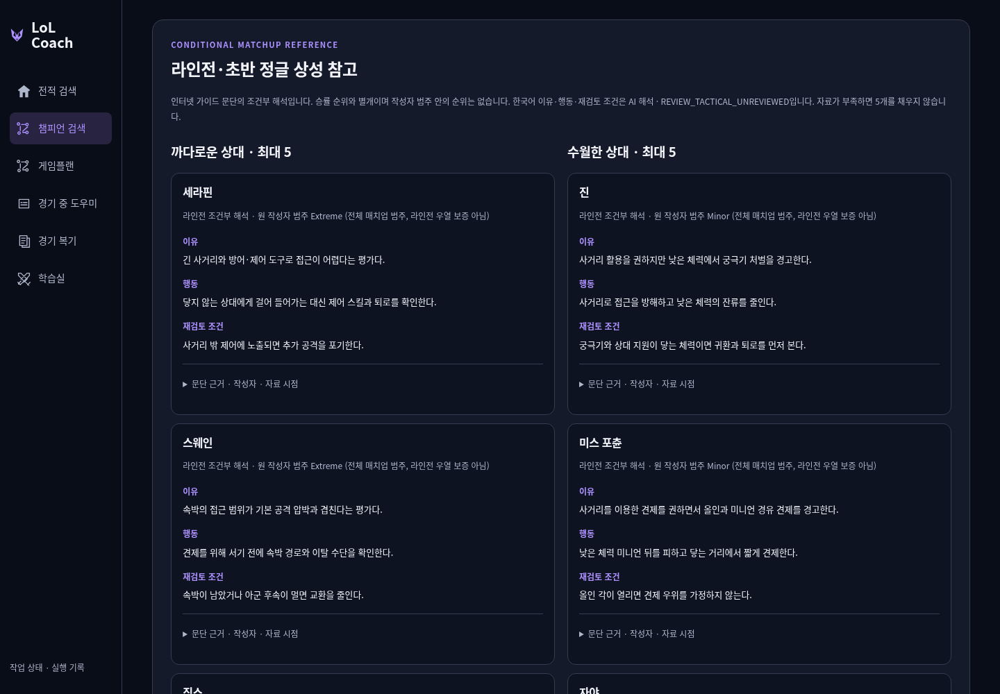
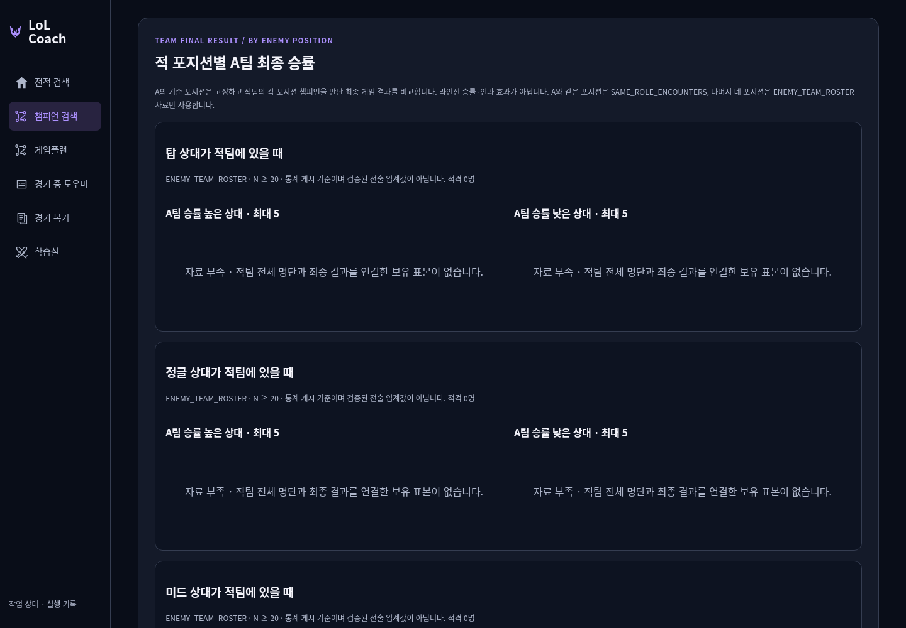
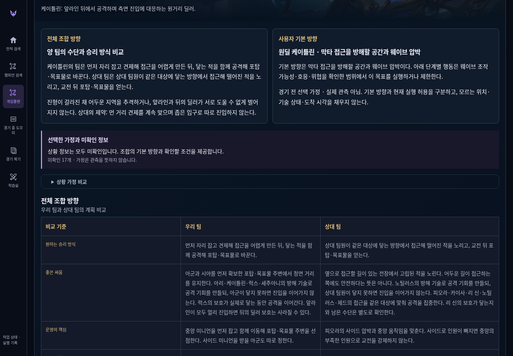
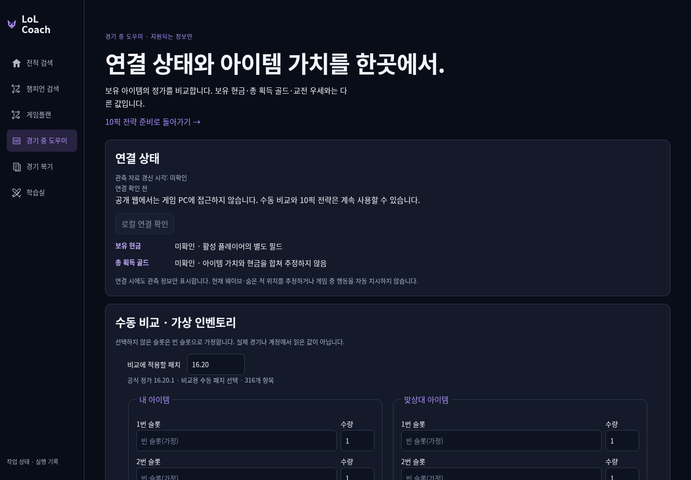
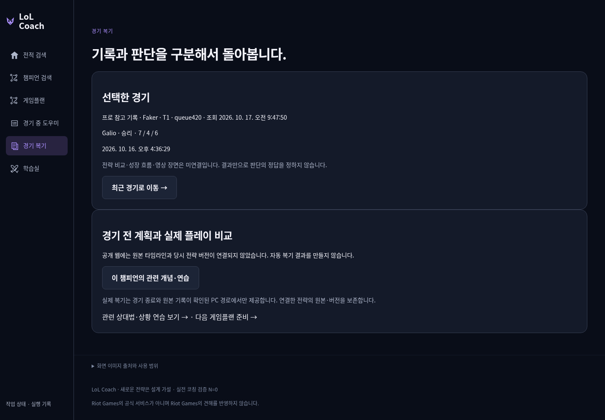
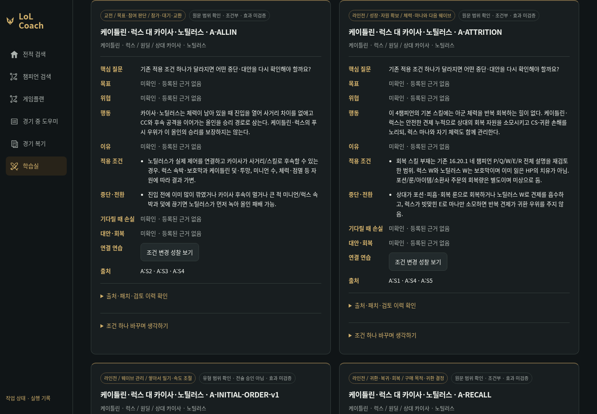
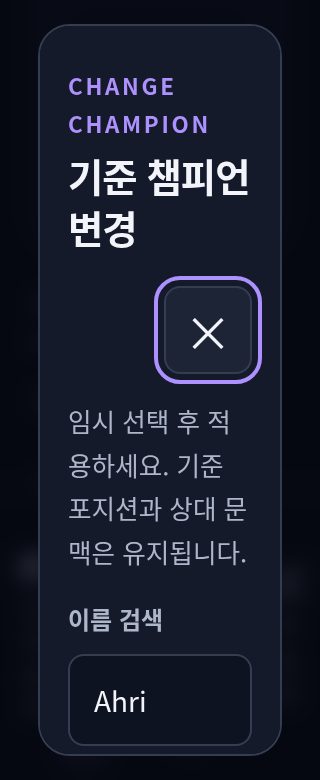

# 페이지별 독립 이미지

2026-10-25 실제공개HTTPS · sourcebe0b83f/artifact9fc318c ·1440×1000PNG. [검증 영수증](live-final/per-page-images.json). 게임플랜은수동입력예시,복기는기존공개Galio7/4/6이며통계표본/실경기전술효과로세지않는다. 전체판정은최종71개검사PASS영수증을따른다.

## 1. 전적 검색

## 2. 챔피언 선택

## 2b. 챔피언 상세

## 2c. 지식 기반 라인전 상성

## 2d. 상대 역할별 게임 승률

## 3. 게임플랜 · 수동 입력 예시

## 4. 경기 중 도우미 · 게임 정보

## 5. 경기 복기 · 기존 공개 프로 기록

## 6. 학습실

## 320px ·200%확대의변경창

