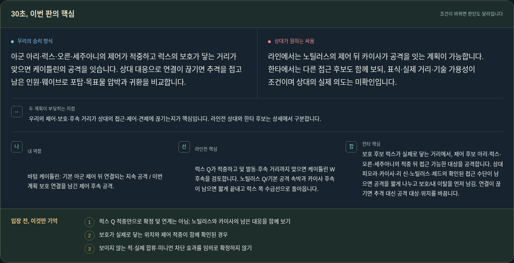
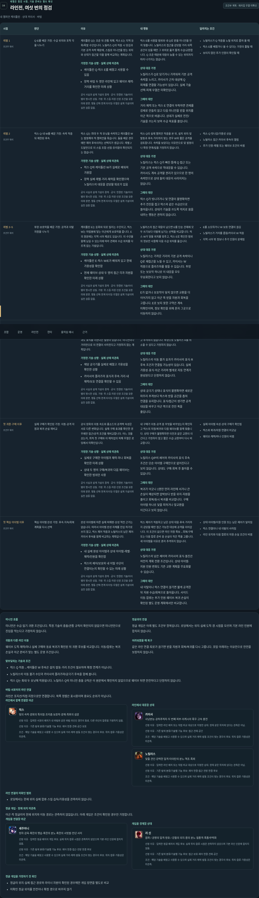
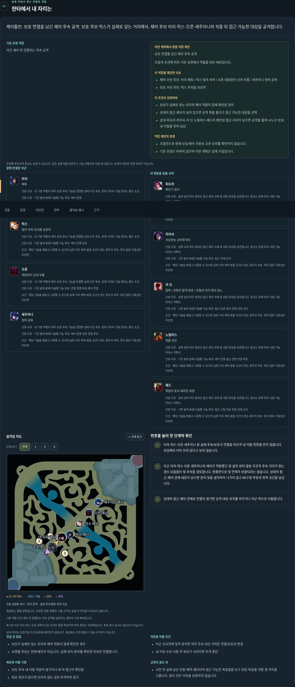
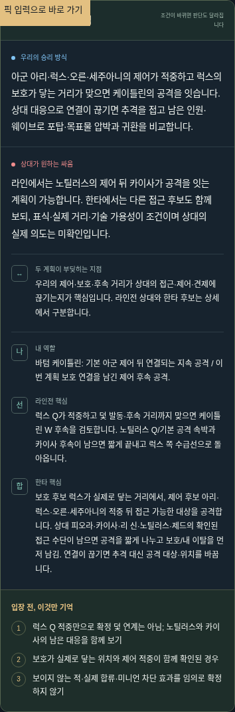

# 문맥 선택 오류 수정과 대표 바텀 매치업 개선

기존 공개주소: https://kco994553-star.github.io/lol-coach/ (이변경의필수CI/게시전에는기존버전). 패치16.20 입력/공식16.20.1. 같은10픽: 아군오른TOP·세주아니JG·아리MID·케이틀린BOTTOM(나)·럭스SUPPORT / 상대피오라TOP·리신JG·제드MID·카이사BOTTOM·노틸러스SUPPORT. 경제입력없음.

## 수정 전 로딩 요약 원문 — mainb9cb5ed

**our_plan**: 케이틀린·럭스의 압박 수단으로 공간을 만들고 오른·세주아니의 후속이 닿을 때 목표물·포탑 압박을 검토합니다.

**enemy_plan**: 상대는 피오라·리 신의 접근 수단을 연결해 떨어진 대상을 노릴 가능성이 있습니다. 적중·아군 거리·가용성이 조건이며 실제 의도는 미확인입니다.

**collision**: 제드·피오라의 접근·압박과 오른·세주아니의 연결이 만나는 순간이 핵심입니다. 먼저 닿는 쪽을 픽만으로 확정할 수 없습니다.

**my_role**: 바텀 케이틀린: 아군 제어 뒤 연결되는 지속 공격. 오른·세주아니와 연결할 수 있는지를 기준으로 역할을 바꿉니다.

**lane_key**: 카이사의 공허추적자 대응과 요들잡이 덫 사용 조건이 맞을 때만 CS 접근·교환 폭을 넓힙니다. 아군 럭스·상대 노틸러스의 연결도 함께 봅니다.

**fight_key**: 제드·피오라의 접근에 오른·세주아니와 거리를 맞춘 뒤 요들잡이 덫의 사용 조건을 고릅니다. 고립되면 추격 대신 연결 회복입니다.

기억할조건:
- 상대 카이사의 대응과 내 요들잡이 덫 조건을 함께 보기
- 오른·세주아니와 후속 거리가 끊기면 전진 폭 줄이기
- 보이지 않는 적을 없다고 보거나 미니언만으로 안전을 확정하지 않기

## 수정 후 로딩 요약 원문 — 신규 설계 가설

**our_plan**: 아군 아리·럭스·오른·세주아니의 제어가 적중하고 럭스의 보호가 닿는 거리가 맞으면 케이틀린의 공격을 잇습니다. 상대 대응으로 연결이 끊기면 추격을 접고 남은 인원·웨이브로 포탑·목표물 압박과 귀환을 비교합니다.

**enemy_plan**: 라인에서는 노틸러스의 제어 뒤 카이사가 공격을 잇는 계획이 가능합니다. 한타에서는 다른 접근 후보도 함께 보되, 표식·실제 거리·기술 가용성이 조건이며 상대의 실제 의도는 미확인입니다.

**collision**: 우리의 제어·보호·후속 거리가 상대의 접근·제어·견제에 끊기는지가 핵심입니다. 라인전 상대와 한타 후보는 상세에서 구분합니다.

**my_role**: 바텀 케이틀린: 기본 아군 제어 뒤 연결되는 지속 공격 / 이번 계획 보호 연결을 남긴 제어 후속 공격.

**lane_key**: 럭스 Q가 적중하고 덫 발동·후속 거리까지 맞으면 케이틀린 W 후속을 검토합니다. 노틸러스 Q/기본 공격 속박과 카이사 후속이 남으면 짧게 끝내고 럭스 쪽 수급선으로 돌아옵니다.

**fight_key**: 보호 후보 럭스가 실제로 닿는 거리에서, 제어 후보 아리·럭스·오른·세주아니의 적중 뒤 접근 가능한 대상을 공격합니다. 상대 피오라·카이사·리 신·노틸러스·제드의 확인된 접근 수단이 남으면 공격을 짧게 나누고 보호/내 이탈을 먼저 남김. 연결이 끊기면 추격 대신 공격 대상·위치를 바꿉니다.

기억할조건:
- 럭스 Q 적중만으로 확정 덫 연계는 아님; 노틸러스와 카이사의 남은 대응을 함께 보기
- 보호가 실제로 닿는 위치와 제어 적중이 함께 확인된 경우
- 보이지 않는 적·실제 합류·미니언 차단 효과를 임의로 확정하지 않기

불확실성:
- 스킬 습득·가용성·체력·웨이브·현재 위치/실제 합류는 로딩에서 미관측
- 요약은 유형별 계획입니다. 상세의 다른 후보 생략을 위협 부재나 중요도 순위로 읽지 마세요.

## 수정된 여섯 구간 표 — 실제 엔진 원문

모든 스킬/자원/인원은 명시한 미래가정이며 현재관측이 아니다. 우열·피해량·최적행동은미확인. 각행의 행동해석은DESIGN_HYPOTHESIS, 실제코칭N=0/정확도null.

| 구간/조건부 판단 | 가정·이유 | 가능한 행동·상대 대응·대안 | 전환 조건 | 근거 범위 |
|---|---|---|---|---|
| 레벨 1 — Q·E를 배운 가정: 수급 위치와 포착 각을 나누기 | 가정: 케이틀린 Q·럭스 E를 배웠고 사용할 수 있음 / 양쪽 바텀 두 명만 라인에 있고 웨이브·체력·거리를 확인한 미래 상황 이유: 케이틀린 Q는 조준 뒤 관통 피해, 럭스 E는 지역 둔화/폭발 수단입니다. 노틸러스 Q의 적중 시 당김과 기본 공격 속박 때문에, 스킬로 미니언을 받는 위치와 상대가 접근할 각을 함께 비교하는 계획입니다. | 행동: 럭스 E를 사용할 범위와 내 Q로 받을 미니언을 먼저 맞춥니다. 노틸러스의 접근을 감당할 거리·뒤쪽 공간이 있을 때만 그 위치로 옮겨 짧게 수급/교환합니다. Q 조준 때문에 대응이 늦을 수 있는 위치까지 따라 나가지는 않습니다. 상대: 노틸러스가 Q로 당기거나 가까워져 기본 공격 속박을 노리고, 카이사가 근처 대상에 Q 피해를 연결할 가능성이 있습니다. 실제 기술 선택·피해 우열은 미확인입니다. 대안: 거리·체력 또는 럭스 E 연결이 부족하면 견제를 강제로 만들지 않고 다음 미니언을 받을 위치를 아군 쪽으로 바꿉니다. 상대가 실제로 전진/기술을 쓰는지 보며 수급 목표를 줄입니다. | 노틸러스가 Q 적중을 노릴 위치로 좁혀 올 때 / 럭스 E를 배웠거나 쓸 수 있다는 가정이 틀릴 때 / 보이지 않던 추가 인원이 확인될 때 | official:Caitlyn:Q, official:Lux:E, official:Nautilus:Q, official:Nautilus:P, official:Kaisa:Q 공식: 연결된 기술/아이템의 명시한 성질. 가정: 위 스킬·자원·인원 조건을 갖춘 미래 장면. 행동 선택·연계 타이밍·우열은 설계 가설이며 실전 검증 없음. |
| 레벨 2 — 럭스 Q·내 W를 배운 가정: 속박 적중 뒤 제한된 후속 | 가정: 럭스 Q와 케이틀린 W가 실제로 배워져 가용함 / 양쪽 실제 레벨·거리·체력을 확인했으며 노틸러스의 대응을 감당할 퇴로가 있음 이유: 럭스 Q는 최대 두 적 유닛을 속박하고 케이틀린 W는 발동해야 적 챔피언을 묶습니다. 둘을 배운 경우에만 제어 후속이라는 선택지가 생깁니다. 레벨 2 도달만으로 이 스킬 조합·선점·유리함이 확인되지는 않습니다. | 행동: 럭스 Q의 실제 챔피언 적중을 본 뒤, 설치 위치·덫 발동과 후속 거리까지 맞는 경우 W와 짧은 공격을 검토합니다. 속박을 보았다는 이유만으로 덫 발동이나 확정 연계/킬을 가정하지 않습니다. 상대: 노틸러스는 럭스 Q가 빠진 틈에 Q 접근 또는 기본 공격 속박으로 역대응할 수 있습니다. 카이사도 계속 공격할 권리가 있으므로 한 명의 속박만으로 상대 둘의 대응이 사라지지는 않습니다. 대안: 럭스 Q가 빗나가거나 덫 연결이 불명확하면 추가 전진을 접고 럭스와 같은 수급선으로 돌아옵니다. 상대가 기술을 쓰도록 억지로 몸을 내주는 행동은 권하지 않습니다. | 럭스 Q 빗나감/가용성 상실 / 노틸러스 접근·카이사 후속이 열림 / 추가 인원·레벨 또는 웨이브 조건이 바뀜 | official:Lux:Q, official:Caitlyn:W, official:Nautilus:Q, official:Nautilus:P, official:Kaisa:Q 공식: 연결된 기술/아이템의 명시한 성질. 가정: 위 스킬·자원·인원 조건을 갖춘 미래 장면. 행동 선택·연계 타이밍·우열은 설계 가설이며 실전 검증 없음. |
| 레벨 3~5 — 투망·보호막을 배운 가정: 공격과 이탈 자원을 나누기 | 가정: 케이틀린 E·럭스 W/E가 배워져 있고 현재 가용성을 확인함 / 현재 웨이브·상대 두 명의 접근 각과 자원을 확인한 미래 상황 이유: 케이틀린 E는 둔화와 뒤로 밀리는 수단이고, 럭스 W는 마법봉에 닿는 아군에게 보호막을 줍니다. E의 원문에는 지역 시야 제공도 있습니다. 이 수단을 함께 남길 수 있는지에 따라 견제와 수급 위치를 다르게 잡는 가설입니다. | 행동: 노틸러스의 접근 대응이 남으면 E를 단순 견제에 모두 쓰기보다 이탈에 남기는 선택을 비교합니다. 럭스 W가 닿을 위치를 맞추고, 럭스 E로 확인한 범위의 정보만 사용해 다음 수급 위치를 옮깁니다. 상대: 노틸러스는 가까운 거리의 기본 공격 속박이나 Q로 재접근을 노릴 수 있고, 카이사는 W 적중으로 플라즈마를 쌓을 수 있습니다. 투망 또는 보호막 하나로 이 대응을 모두 무효화한다고 보지 않습니다. 대안: E가 없거나 보호막이 닿지 않으면 교환을 더 이어가지 않고 아군 쪽 받을 자원과 회복을 고릅니다. E로 보지 못한 구역은 계속 미확인이며, 정보 확인을 위해 혼자 그곳으로 이동하지 않습니다. | E를 소모하거나 W 보호 연결이 끊김 / 노틸러스가 거리를 좁힘/카이사 W 적중 / 지역 시야 밖 정보나 추가 인원이 문제됨 | official:Caitlyn:E, official:Lux:W, official-detail:Lux:W, official-detail:Lux:E, official:Nautilus:Q, official:Nautilus:P, official:Kaisa:W 공식: 연결된 기술/아이템의 명시한 성질. 가정: 위 스킬·자원·인원 조건을 갖춘 미래 장면. 행동 선택·연계 타이밍·우열은 설계 가설이며 실전 검증 없음. |
| 레벨 6 — 궁극기를 배운 가정: 표식·추적 제어까지 포함해 배치 변경 | 가정: 해당 궁극기를 실제로 배웠고 가용성을 확인한 상황 / 카이사의 플라즈마 표식과 후속 거리·내 체력/보호 연결을 확인할 수 있음 이유: 노틸러스 R은 대상을 추적해 띄우고 기절시키며, 카이사 R 상세 원문은 플라즈마 표식 대상 근처 돌진을 요구합니다. 카이사 P에는 아군 이동 불가 효과도 표식을 더한다는 설명이 있습니다. 미니언이나 거리만으로 이 연결이 사라진다고 가정하지 않는 계획입니다. | 행동: 추적 제어와 표식 후속이 열릴 경우 럭스 W가 닿을 거리와 이탈 공간부터 맞춥니다. 케이틀린 R은 적 챔피언이 대신 막을 수 있으므로 마무리가 보장된다고 추격하지 않습니다. 투망으로 노틸러스 R을 취소할 수 있다고 가정하지 않습니다. 상대: 노틸러스의 이동 불가 효과가 카이사의 표식·R 후속 조건과 연결될 가능성이 있습니다. 실제 가용성·표식·아군 거리와 별개로 자동 연계가 완성된다고 단정하지 않습니다. 대안: 상대 궁극기 상태나 표식이 불명확하면 새로운 마무리 추격보다 럭스와 받을 공간을 좁혀 연결을 유지합니다. 표식/접근이 생기면 공격 대상을 바꾸고 아군 쪽으로 전진 폭을 줄입니다. | 표식·추적 제어·카이사 후속 거리가 확인됨 / 럭스 보호 연결이나 내 이탈 자원 상실 / 상대 궁극기 가용성이 달라짐 | official:Nautilus:R, official:Kaisa:P, official-detail:Kaisa:R, official:Caitlyn:R, official:Caitlyn:E, official-detail:Lux:W 공식: 연결된 기술/아이템의 명시한 성질. 가정: 위 스킬·자원·인원 조건을 갖춘 미래 장면. 행동 선택·연계 타이밍·우열은 설계 가설이며 실전 검증 없음. |
| 첫 귀환·구매 이후 — 실제 구매가 확인된 가정: 이동·공격 자원과 복귀 손실 재비교 | 가정: 실제로 구매한 아이템과 체력·마나 회복을 확인한 미래 상황 / 상대 두 명의 구매/복귀와 다음 웨이브는 확인한 범위만 사용 이유: 공식 장화의 이동 속도와 롱소드의 공격력 속성은 서로 다른 변화입니다. 실제 구매 효과를 확인한 경우에만 접근/공격 조건을 재비교합니다. 어느 것을 샀는지, 최적 첫 구매와 이 매치업의 피해 우열은 로딩에서 미확인입니다. | 행동: 내 구매가 이동·공격 중 무엇을 바꾸었는지 확인하고 럭스의 자원/복귀와 다음 웨이브를 함께 맞춥니다. 상대 구매가 불명확하면 이전과 같은 교환이 이긴다고 가정하지 않고 짧은 수급·교환부터 다시 비교합니다. 상대: 노틸러스 Q/P의 제어와 카이사의 표식 후속 조건은 단순 아이템 구매만으로 없어진다고 보지 않습니다. 상대도 구매·회복 후 돌아올 수 있습니다. 대안: 복귀가 어긋나 1명만 먼저 라인에 서거나 큰 손실이 예상되면 압박보다 받을 위치·자원을 줄이고 회복/동시 복귀를 비교합니다. 구매 아이템 하나로 닻을 피하거나 맞교환을 이긴다고 보지 않습니다. | 실제 아이템 속성·상대 구매가 확인됨 / 럭스와 복귀/자원 연결이 어긋남 / 웨이브·체력/마나·인원이 바뀜 | official-item:1001, official-item:1036, official:Nautilus:Q, official:Nautilus:P, official:Kaisa:P 공식: 연결된 기술/아이템의 명시한 성질. 가정: 위 스킬·자원·인원 조건을 갖춘 미래 장면. 행동 선택·연계 타이밍·우열은 설계 가설이며 실전 검증 없음. |
| 첫 핵심 아이템 이후 — 핵심 아이템 완성 가정: 후속 지속/회복 계획을 다시 선택 | 가정: 내 실제 완성 아이템과 상대 아이템·레벨·체력/인원을 확인함 / 럭스의 제어/보호와 내 이탈 수단이 연결되는지 확인할 수 있는 미래 상황 이유: 완성 아이템에 따른 실제 피해량·상성 역전 근거는 없습니다. 따라서 아이템 완성 자체를 진입 허가로 쓰지 않고, 럭스 제어 적중과 노틸러스의 남은 제어·카이사 후속을 함께 비교하는 계획입니다. | 행동: 럭스 제어가 적중하고 남은 상대 대응·후속 거리까지 감당할 때만 접근 가능한 대상에 공격을 이어갑니다. 이 조건이 없으면 라인 자원 확보→회복/구매 또는 다음 합류 준비 중 손실이 작은 쪽을 고릅니다. 새 아이템을 이유로 혼자 추격하지 않습니다. 상대: 노틸러스의 남은 제어와 카이사의 표식·돌진은 여전히 계획 전환 조건입니다. 상대 아이템·지원 인원 변화도 기존 교환 계획을 무효화할 수 있습니다. 대안: 내 이탈이나 럭스 연결이 끊기면 짧게 공격한 뒤 자원 수급/회복으로 돌아옵니다. 사이드 이동·합류는 추가 인원·웨이브·복귀 손실이 확인된 별도 운영 계획에서만 비교합니다. | 상대 아이템/지원 인원 또는 남은 제어가 달라짐 / 럭스 연결이나 내 이탈이 사라짐 / 라인 유지와 다음 합류의 자원 손실 조건이 바뀜 | official:Lux:Q, official-detail:Lux:W, official:Caitlyn:E, official:Nautilus:R, official-detail:Kaisa:R 공식: 연결된 기술/아이템의 명시한 성질. 가정: 위 스킬·자원·인원 조건을 갖춘 미래 장면. 행동 선택·연계 타이밍·우열은 설계 가설이며 실전 검증 없음. |

## 문맥별 대상과 선정 이유

### lane — 실제 위치·합류 관측 아님

- 협력 럭스 / 빛의 속박·광휘의 특이점·프리즘 보호막·광채·최후의 섬광 / 입력한 서포터 배치가 내 바텀와 같은 바텀 라인인 경우의 동료. 다른 라인의 합류를 가정하지 않음. 기존 탐색 분류/기술별 기능 후보: 제어 연결·견제·공간·보호 / 해당 기술을 배웠고 사용할 수 있으며 실제 거리·체력·발동 조건이 맞는 경우의 후보. 위치·합류·가용성은 미관측.
- 상대 카이사 / 사냥본능·공허추적자·두 번째 피부·이케시아 폭우·고속 충전 / 입력한 라인 배치 또는 직접 비교 대상으로 지정한 상대. 현재 같은 위치에 있다는 관측은 아님. 기존 탐색 분류/기술별 기능 후보: 접근·견제·공간 / 해당 기술을 배웠고 사용할 수 있으며 실제 거리·체력·발동 조건이 맞는 경우의 후보. 위치·합류·가용성은 미관측.
- 상대 노틸러스 / 닻줄 견인·강력한 일격·타이탄의 분노·역조·폭뢰 / 입력한 라인 배치 또는 직접 비교 대상으로 지정한 상대. 현재 같은 위치에 있다는 관측은 아님. 기존 탐색 분류/기술별 기능 후보: 제어 연결·접근·전방 연결 후보 / 해당 기술을 배웠고 사용할 수 있으며 실제 거리·체력·발동 조건이 맞는 경우의 후보. 위치·합류·가용성은 미관측.

### jungle — 실제 위치·합류 관측 아님

- 협력 세주아니 / 빙하 감옥·혹한의 맹습·혹한의 분노·혹한의 서릿발·만년 서리 / 입력한 정글 배치의 개입 후보. 실제 위치·합류 시점은 관측하지 않았으며 기본 라인 인원에 합치지 않음. 기존 탐색 분류/기술별 기능 후보: 제어 연결·접근·전방 연결 후보 / 해당 기술을 배웠고 사용할 수 있으며 실제 거리·체력·발동 조건이 맞는 경우의 후보. 위치·합류·가용성은 미관측.
- 상대 리 신 / 음파 / 공명의 일격·방호 / 강철의 의지·용의 분노·질풍격·폭풍/무력화 / 입력한 정글 배치의 개입 후보. 실제 위치·합류 시점은 관측하지 않았으며 기본 라인 인원에 합치지 않음. 기존 탐색 분류/기술별 기능 후보: 접근·보호·제어 연결·견제·공간 / 해당 기술을 배웠고 사용할 수 있으며 실제 거리·체력·발동 조건이 맞는 경우의 후보. 위치·합류·가용성은 미관측.

### operations — 실제 위치·합류 관측 아님

- 협력 아리 / 매혹·현혹의 구슬 / 웨이브·목표물·복귀 계획을 연결할 실제 아군 후보. 같은 위치/합류는 가정하지 않음. 기존 탐색 분류/기술별 기능 후보: 제어 연결·견제·공간 / 해당 기술을 배웠고 사용할 수 있으며 실제 거리·체력·발동 조건이 맞는 경우의 후보. 위치·합류·가용성은 미관측.
- 협력 럭스 / 빛의 속박·광휘의 특이점·프리즘 보호막 / 웨이브·목표물·복귀 계획을 연결할 실제 아군 후보. 같은 위치/합류는 가정하지 않음. 기존 탐색 분류/기술별 기능 후보: 제어 연결·견제·공간·보호 / 해당 기술을 배웠고 사용할 수 있으며 실제 거리·체력·발동 조건이 맞는 경우의 후보. 위치·합류·가용성은 미관측.
- 협력 오른 / 대장장이 신의 부름·용암 균열 / 웨이브·목표물·복귀 계획을 연결할 실제 아군 후보. 같은 위치/합류는 가정하지 않음. 기존 탐색 분류/기술별 기능 후보: 전방 연결 후보·제어 연결·견제·공간 / 해당 기술을 배웠고 사용할 수 있으며 실제 거리·체력·발동 조건이 맞는 경우의 후보. 위치·합류·가용성은 미관측.
- 협력 세주아니 / 빙하 감옥 / 웨이브·목표물·복귀 계획을 연결할 실제 아군 후보. 같은 위치/합류는 가정하지 않음. 기존 탐색 분류/기술별 기능 후보: 제어 연결·전방 연결 후보 / 해당 기술을 배웠고 사용할 수 있으며 실제 거리·체력·발동 조건이 맞는 경우의 후보. 위치·합류·가용성은 미관측.
- 상대 피오라 / 찌르기·응수 / 실제 상대 픽의 알려진 접근·제어·견제 등 대응 후보를 보존합니다. 중요도·현재 위치·사용 가능 여부는 미확인. 기존 탐색 분류/기술별 기능 후보: 접근·제어 연결 / 해당 기술을 배웠고 사용할 수 있으며 실제 거리·체력·발동 조건이 맞는 경우의 후보. 위치·합류·가용성은 미관측.
- 상대 카이사 / 사냥본능·공허추적자 / 실제 상대 픽의 알려진 접근·제어·견제 등 대응 후보를 보존합니다. 중요도·현재 위치·사용 가능 여부는 미확인. 기존 탐색 분류/기술별 기능 후보: 접근·견제·공간 / 해당 기술을 배웠고 사용할 수 있으며 실제 거리·체력·발동 조건이 맞는 경우의 후보. 위치·합류·가용성은 미관측.
- 상대 리 신 / 음파 / 공명의 일격·방호 / 강철의 의지·용의 분노 / 실제 상대 픽의 알려진 접근·제어·견제 등 대응 후보를 보존합니다. 중요도·현재 위치·사용 가능 여부는 미확인. 기존 탐색 분류/기술별 기능 후보: 접근·보호·제어 연결·견제·공간 / 해당 기술을 배웠고 사용할 수 있으며 실제 거리·체력·발동 조건이 맞는 경우의 후보. 위치·합류·가용성은 미관측.
- 상대 노틸러스 / 닻줄 견인 / 실제 상대 픽의 알려진 접근·제어·견제 등 대응 후보를 보존합니다. 중요도·현재 위치·사용 가능 여부는 미확인. 기존 탐색 분류/기술별 기능 후보: 제어 연결·접근·전방 연결 후보 / 해당 기술을 배웠고 사용할 수 있으며 실제 거리·체력·발동 조건이 맞는 경우의 후보. 위치·합류·가용성은 미관측.
- 상대 제드 / 죽음의 표식·예리한 표창 / 실제 상대 픽의 알려진 접근·제어·견제 등 대응 후보를 보존합니다. 중요도·현재 위치·사용 가능 여부는 미확인. 기존 탐색 분류/기술별 기능 후보: 접근·고립 대상 위협·견제·공간 / 해당 기술을 배웠고 사용할 수 있으며 실제 거리·체력·발동 조건이 맞는 경우의 후보. 위치·합류·가용성은 미관측.

### teamfight — 실제 위치·합류 관측 아님

- 협력 아리 / 매혹 / 내 기본 역할과 제어·보호·후속 기능을 연결할 실제 아군 후보. 현재 거리와 기술 준비는 별도 조건. 기존 탐색 분류/기술별 기능 후보: 제어 연결 / 해당 기술을 배웠고 사용할 수 있으며 실제 거리·체력·발동 조건이 맞는 경우의 후보. 위치·합류·가용성은 미관측.
- 협력 럭스 / 빛의 속박·프리즘 보호막 / 내 기본 역할과 제어·보호·후속 기능을 연결할 실제 아군 후보. 현재 거리와 기술 준비는 별도 조건. 기존 탐색 분류/기술별 기능 후보: 제어 연결·보호 / 해당 기술을 배웠고 사용할 수 있으며 실제 거리·체력·발동 조건이 맞는 경우의 후보. 위치·합류·가용성은 미관측.
- 협력 오른 / 대장장이 신의 부름 / 내 기본 역할과 제어·보호·후속 기능을 연결할 실제 아군 후보. 현재 거리와 기술 준비는 별도 조건. 기존 탐색 분류/기술별 기능 후보: 전방 연결 후보·제어 연결 / 해당 기술을 배웠고 사용할 수 있으며 실제 거리·체력·발동 조건이 맞는 경우의 후보. 위치·합류·가용성은 미관측.
- 협력 세주아니 / 빙하 감옥 / 내 기본 역할과 제어·보호·후속 기능을 연결할 실제 아군 후보. 현재 거리와 기술 준비는 별도 조건. 기존 탐색 분류/기술별 기능 후보: 제어 연결·전방 연결 후보 / 해당 기술을 배웠고 사용할 수 있으며 실제 거리·체력·발동 조건이 맞는 경우의 후보. 위치·합류·가용성은 미관측.
- 상대 피오라 / 찌르기·응수 / 실제 상대 픽의 알려진 접근·제어·견제 등 대응 후보를 보존합니다. 중요도·현재 위치·사용 가능 여부는 미확인. 기존 탐색 분류/기술별 기능 후보: 접근·제어 연결 / 해당 기술을 배웠고 사용할 수 있으며 실제 거리·체력·발동 조건이 맞는 경우의 후보. 위치·합류·가용성은 미관측.
- 상대 카이사 / 사냥본능·공허추적자 / 실제 상대 픽의 알려진 접근·제어·견제 등 대응 후보를 보존합니다. 중요도·현재 위치·사용 가능 여부는 미확인. 기존 탐색 분류/기술별 기능 후보: 접근·견제·공간 / 해당 기술을 배웠고 사용할 수 있으며 실제 거리·체력·발동 조건이 맞는 경우의 후보. 위치·합류·가용성은 미관측.
- 상대 리 신 / 음파 / 공명의 일격·방호 / 강철의 의지·용의 분노 / 실제 상대 픽의 알려진 접근·제어·견제 등 대응 후보를 보존합니다. 중요도·현재 위치·사용 가능 여부는 미확인. 기존 탐색 분류/기술별 기능 후보: 접근·보호·제어 연결·견제·공간 / 해당 기술을 배웠고 사용할 수 있으며 실제 거리·체력·발동 조건이 맞는 경우의 후보. 위치·합류·가용성은 미관측.
- 상대 노틸러스 / 닻줄 견인 / 실제 상대 픽의 알려진 접근·제어·견제 등 대응 후보를 보존합니다. 중요도·현재 위치·사용 가능 여부는 미확인. 기존 탐색 분류/기술별 기능 후보: 제어 연결·접근·전방 연결 후보 / 해당 기술을 배웠고 사용할 수 있으며 실제 거리·체력·발동 조건이 맞는 경우의 후보. 위치·합류·가용성은 미관측.
- 상대 제드 / 죽음의 표식·예리한 표창 / 실제 상대 픽의 알려진 접근·제어·견제 등 대응 후보를 보존합니다. 중요도·현재 위치·사용 가능 여부는 미확인. 기존 탐색 분류/기술별 기능 후보: 접근·고립 대상 위협·견제·공간 / 해당 기술을 배웠고 사용할 수 있으며 실제 거리·체력·발동 조건이 맞는 경우의 후보. 위치·합류·가용성은 미관측.

단순첫2명/임의점수·가중치/중요도순위가없다. 표시순서만ID로안정화했다. 라인은배치관계, 정글은별도개입가정, 운영은접근공간/웨이브/복귀등조건의연결후보, 한타는기본역할의제어·보호·후속기능후보를쓴다. 요약생략은다른후보의위협부재가아니다.

## 기본 유형과 이번 계획의 역할

{
  "base": {
    "id": "FOLLOW_DAMAGE",
    "label": "아군 제어 뒤 연결되는 지속 공격",
    "types": [
      "Marksman"
    ],
    "scope": "챔피언·포지션의 기본 분류 · 전술 효과 미검증"
  },
  "proposed": {
    "id": "CONTROL_WITH_COVER",
    "label": "보호 연결을 남긴 제어 후속 공격",
    "reasons": [
      "제어 수단 후보: 아리 매혹 / 럭스 빛의 속박 / 오른 대장장이 신의 부름 / 세주아니 빙하 감옥",
      "보호 수단 후보: 럭스 프리즘 보호막"
    ],
    "conditions": [
      "보호가 실제로 닿는 위치와 제어 적중이 함께 확인된 경우",
      "상대의 접근·제어가 남아 있으면 공격 폭을 줄이고 접근 가능한 대상을 선택",
      "상대 피오라·카이사·리 신·노틸러스·제드의 확인된 접근 수단이 남으면 공격을 짧게 나누고 보호/내 이탈을 먼저 남김"
    ],
    "limits": [
      "조합만으로 현재 보호/제어 가용성·교전 승리를 확인하지 않습니다.",
      "기본 유형은 바뀌지 않으며 이번 계획은 설계 가설입니다."
    ],
    "action_ids": [
      "FOLLOW_CONFIRMED_CONTROL",
      "KEEP_COVER_CONNECTION",
      "CHANGE_TARGET_IF_ACCESS_OPENS",
      "RESPECT_CONFIRMED_ENTRY"
    ]
  },
  "changed": true
}

## 반례 결과와 검증 범위

사전기대는contracts/loading-context-v2.md에고정. tests_pregame/test_loading_context.py는배열순열,아군/적서포터교체,먼탑변경,부분배치미확인,배치뒤집힘,제어미확인시실제후속행동제거를검사한다. 단순문자열변화가아니라배우집합·기술출처·역할조건/행동분기·라인객체불변·지도배우멤버십을대조한다. counterexamples.json에는각입력의기대와실제분기를저장했다.
독립검토는초기3P2(부분배치에서알려진서포터소실,배치교환템플릿오용,제어미확인인데덫후속잔존)를찾았고 각각RED→수정→GREEN했다. 별도240순열원문대조/9문맥검사는의미일관성증거이며코칭정확도가아니다. 근거·조건적유용성·실전효과를구분한다.
최종실제PC/공개하위경로·390px브라우저: ../loading/browser-20261017T051720644389Z/runner.json (해시일치). 수동10픽/상대정정/미확인·배열뒤집기·먼탑불변·양쪽서포터교체·원딜미확인시노틸유지·배치교환비적용·제어미확인시구체덫후속제거·가져오기수동전환·지도번호/확대PASS. 선행051128/051155/051330는중간구성증거로보존하고최종소스증거로쓰지않는다.

## 근거 부족 질문과 다음 대상

evidence-questions.json의질문은L1수급/거리·L2속박후덫조건·L3~5투망/보호자원·L6표식/추적제어·첫구매속성변화·핵심아이템/실제강화후전환이다. 우선땅우양·정뚱땡·이브등기존바텀및서포터설명/자막후보중이질문에답하는구간을찾는다. 현재관련강의구간채택0. 베베핑크·풀영상·HecarimKing등사용자지정미확인정보는등록완료/독립발언으로꾸미지않고신원/관련구간대기로보존한다. POV는발언근거로쓰지않는다.
오늘10/17KSTVIDEO3/3·추가텍스트/영상/경기/유료/자산요청0. 기존10/18③→별도검토/CI게시→④와진단종료후하루1구간원칙을변경하지않는다. 새예약/차감/환급/재시도0. 사용자에게전수검토나수집을넘기지않는다.

## 보존과 한계

기존865설명사실·353귀환집계·6장면은baseline-projection.json 해시와같다. 별도상세사실5개는보관원문의카이사R/럭스W/E툴팁과장화/롱소드속성에서오프라인추출했다. 미평가템플릿수치/아이템속성을피해량·최적빌드·권장금액으로바꾸지않는다. 신규경기/영상/강의근거0, 전문가채택0, 충분한판단전장면/실경기평가0.
공식기술설명이옳음은계획최적성증명이아니다. 노틸러스Q의미니언충돌·실제교환우열·레벨선점·구매후승패/진화기준·확정덫연계·투망R취소는검증으로승격하지않았다. 기존조언7/AUTO30/HOLD20/USER0/Frozen350/실패이력/Windows실행·수동전환·정책경계를보존했다. 실제Windows는BLOCKED_EXTERNAL.
필수CI/정상병합/병합후검사와실제공개게시확인은별도게이트이며이본문시점미래성공을단정하지않는다. 실제결과는publication영수증으로추가한다.

요약의 마지막 조건/행동 문구 수정은 summary-review.md에 별도 검토합니다. 초기 개선 스냅샷 after-initial.json/report-initial.md를 보존했습니다.

원본 semantic-red.log의 Node diff 출력에 공백만 있는 줄이 있어 최초 커밋 전 whitespace 검사가 멈췄고 PR 생성도 커밋 부재로 실패했다. 코드·문서는 검사 통과, 실패 stdout 원문은 수정하지 않고 보존했다. 실제 PR/CI는 이후 성공 영수증으로 구분한다.
