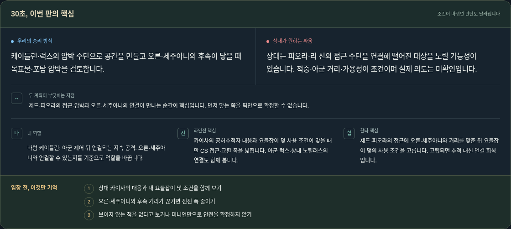
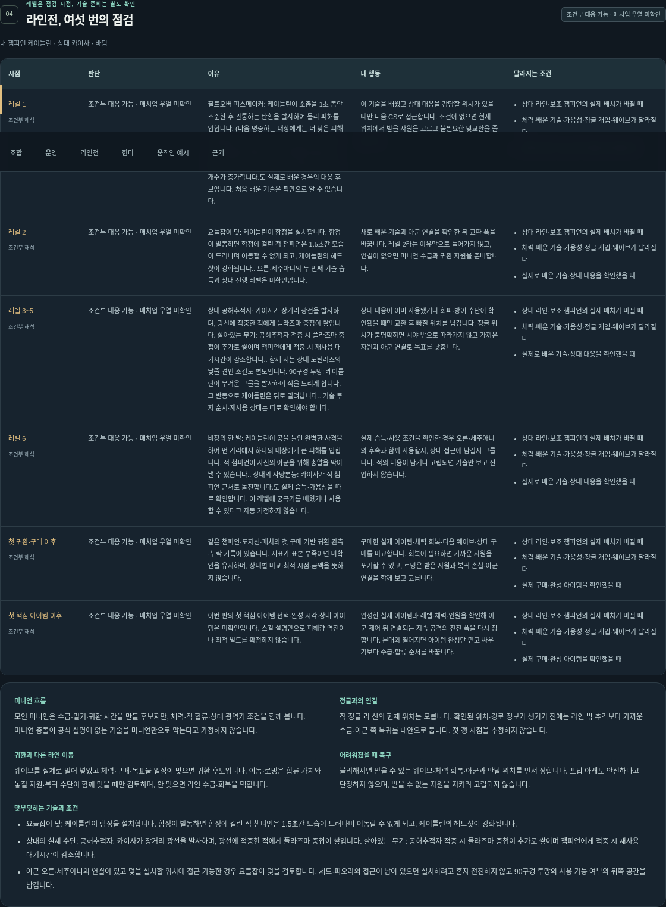
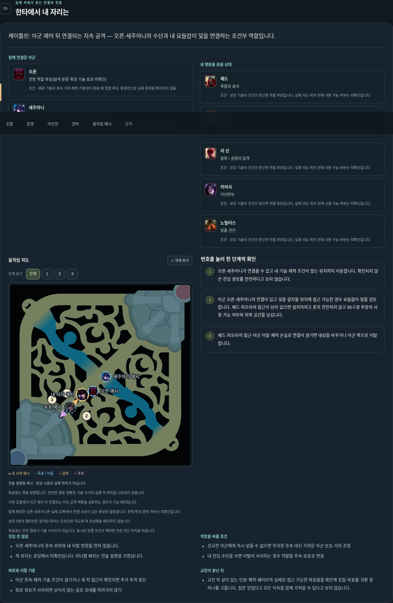
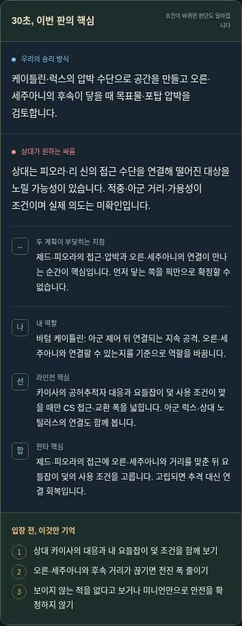
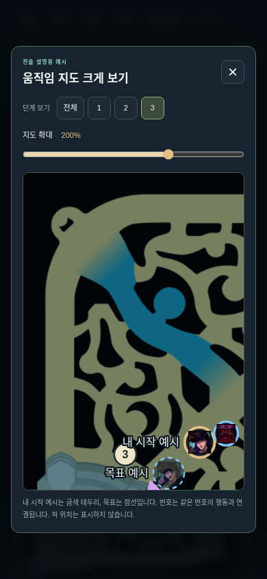

# 10픽 Loading Strategy MVP 결과

사용 주소(기존 Pages 업데이트 대상): https://kco994553-star.github.io/lol-coach/
사용 순서: 아군5·적군5 검색 → 내 챔피언·포지션 → 이번 판 방향 보기 → 핵심 요약 → 라인전/운영/한타/지도/근거. 경제·웨이브·시야 입력 없이 기본 전략이 나온다.

## 예시 입력과 실제 생성 요약 원문

아군: 오른(TOP)·세주아니(JUNGLE)·아리(MID)·케이틀린(BOTTOM, 나)·럭스(SUPPORT). 상대: 피오라·리 신·제드·카이사·노틸러스(같은 포지션 순). 입력16.20 / 공식16.20.1 / BLUE.

우리 계획: 케이틀린·럭스의 압박 수단으로 공간을 만들고 오른·세주아니의 후속이 닿을 때 목표물·포탑 압박을 검토합니다.

상대 가능 계획: 상대는 피오라·리 신의 접근 수단을 연결해 떨어진 대상을 노릴 가능성이 있습니다. 적중·아군 거리·가용성이 조건이며 실제 의도는 미확인입니다.

충돌: 제드·피오라의 접근·압박과 오른·세주아니의 연결이 만나는 순간이 핵심입니다. 먼저 닿는 쪽을 픽만으로 확정할 수 없습니다.

내 역할: 바텀 케이틀린: 아군 제어 뒤 연결되는 지속 공격. 오른·세주아니와 연결할 수 있는지를 기준으로 역할을 바꿉니다.

라인전: 카이사의 공허추적자 대응과 요들잡이 덫 사용 조건이 맞을 때만 CS 접근·교환 폭을 넓힙니다. 아군 럭스·상대 노틸러스의 연결도 함께 봅니다.

한타: 제드·피오라의 접근에 오른·세주아니와 거리를 맞춘 뒤 요들잡이 덫의 사용 조건을 고릅니다. 고립되면 추격 대신 연결 회복입니다.

기억할 조건:
- 상대 카이사의 대응과 내 요들잡이 덫 조건을 함께 보기
- 오른·세주아니와 후속 거리가 끊기면 전진 폭 줄이기
- 보이지 않는 적을 없다고 보거나 미니언만으로 안전을 확정하지 않기

중요 불확실성:
- 기술 습득·가용성·체력·웨이브·적 정글 위치는 로딩에서 미확인

## 라인전 상세 표 — 실제 엔진 원문

| 구간 | 판단 | 강약 원인/한계 | 행동 방향 | 전환 조건 |
|---|---|---|---|---|
| 레벨 1 | 조건부 대응 가능 · 매치업 우열 미확인 | 필트오버 피스메이커: 케이틀린이 소총을 1초 동안 조준한 후 관통하는 탄환을 발사하여 물리 피해를 입힙니다. (다음 명중하는 대상에게는 더 낮은 피해가 들어갑니다.). 상대의 이케시아 폭우: 카이사가 근처 적들을 추격하는 미사일 세례를 퍼붓습니다. 살아있는 무기: 이케시아 폭우가 발사하는 미사일 개수가 증가합니다.도 실제로 배운 경우의 대응 후보입니다. 처음 배운 기술은 픽만으로 알 수 없습니다. | 이 기술을 배웠고 상대 대응을 감당할 위치가 있을 때만 다음 CS로 접근합니다. 조건이 없으면 현재 위치에서 받을 자원을 고르고 불필요한 맞교환을 줄입니다. | 상대 라인·보조 챔피언의 실제 배치가 바뀔 때 / 체력·배운 기술·가용성·정글 개입·웨이브가 달라질 때 / 실제로 배운 기술·상대 대응을 확인했을 때 |
| 레벨 2 | 조건부 대응 가능 · 매치업 우열 미확인 | 요들잡이 덫: 케이틀린이 함정을 설치합니다. 함정이 발동하면 함정에 걸린 적 챔피언은 1.5초간 모습이 드러나며 이동할 수 없게 되고, 케이틀린의 헤드샷이 강화됩니다.. 오른·세주아니의 두 번째 기술 습득과 상대 선행 레벨은 미확인입니다. | 새로 배운 기술과 아군 연결을 확인한 뒤 교환 폭을 바꿉니다. 레벨 2라는 이유만으로 들어가지 않고, 연결이 없으면 미니언 수급과 귀환 자원을 준비합니다. | 상대 라인·보조 챔피언의 실제 배치가 바뀔 때 / 체력·배운 기술·가용성·정글 개입·웨이브가 달라질 때 / 실제로 배운 기술·상대 대응을 확인했을 때 |
| 레벨 3~5 | 조건부 대응 가능 · 매치업 우열 미확인 | 상대 공허추적자: 카이사가 장거리 광선을 발사하며, 광선에 적중한 적에게 플라즈마 중첩이 쌓입니다. 살아있는 무기: 공허추적자 적중 시 플라즈마 중첩이 추가로 쌓이며 챔피언에게 적중 시 재사용 대기시간이 감소합니다.. 함께 서는 상대 노틸러스의 닻줄 견인 조건도 별도입니다. 90구경 투망: 케이틀린이 무거운 그물을 발사하여 적을 느리게 합니다. 그 반동으로 케이틀린은 뒤로 밀려납니다.. 기술 투자 순서·재사용 상태는 따로 확인해야 합니다. | 상대 대응이 이미 사용됐거나 회피·방어 수단이 확인됐을 때만 교환 후 빠질 위치를 남깁니다. 정글 위치가 불명확하면 시야 밖으로 따라가지 않고 가까운 자원과 아군 연결로 목표를 낮춥니다. | 상대 라인·보조 챔피언의 실제 배치가 바뀔 때 / 체력·배운 기술·가용성·정글 개입·웨이브가 달라질 때 / 실제로 배운 기술·상대 대응을 확인했을 때 |
| 레벨 6 | 조건부 대응 가능 · 매치업 우열 미확인 | 비장의 한 발: 케이틀린이 공을 들인 완벽한 사격을 하여 먼 거리에서 하나의 대상에게 큰 피해를 입힙니다. 적 챔피언이 자신의 아군을 위해 총알을 막아낼 수 있습니다.. 상대의 사냥본능: 카이사가 적 챔피언 근처로 돌진합니다.도 실제 습득·가용성을 따로 확인합니다. 이 레벨에 궁극기를 배웠거나 사용할 수 있다고 자동 가정하지 않습니다. | 실제 습득·사용 조건을 확인한 경우 오른·세주아니의 후속과 함께 사용할지, 상대 접근에 남길지 고릅니다. 적의 대응이 남거나 고립되면 기술만 보고 진입하지 않습니다. | 상대 라인·보조 챔피언의 실제 배치가 바뀔 때 / 체력·배운 기술·가용성·정글 개입·웨이브가 달라질 때 / 실제로 배운 기술·상대 대응을 확인했을 때 |
| 첫 귀환·구매 이후 | 조건부 대응 가능 · 매치업 우열 미확인 | 같은 챔피언·포지션·패치의 첫 구매 기반 귀환 관측·누락 기록이 있습니다. 지표가 표본 부족이면 미확인을 유지하며, 상대별 비교·최적 시점·금액을 뜻하지 않습니다. | 구매한 실제 아이템·체력 회복·다음 웨이브·상대 구매를 비교합니다. 회복이 필요하면 가까운 자원을 포기할 수 있고, 로밍은 받은 자원과 복귀 손실·아군 연결을 함께 보고 고릅니다. | 상대 라인·보조 챔피언의 실제 배치가 바뀔 때 / 체력·배운 기술·가용성·정글 개입·웨이브가 달라질 때 / 실제 구매·완성 아이템을 확인했을 때 |
| 첫 핵심 아이템 이후 | 조건부 대응 가능 · 매치업 우열 미확인 | 이번 판의 첫 핵심 아이템 선택·완성 시각·상대 아이템은 미확인입니다. 스킬 설명만으로 피해량 역전이나 최적 빌드를 확정하지 않습니다. | 완성한 실제 아이템과 레벨·체력·인원을 확인해 아군 제어 뒤 연결되는 지속 공격의 전진 폭을 다시 정합니다. 본대와 떨어지면 아이템 완성만 믿고 싸우기보다 수급·합류 순서를 바꿉니다. | 상대 라인·보조 챔피언의 실제 배치가 바뀔 때 / 체력·배운 기술·가용성·정글 개입·웨이브가 달라질 때 / 실제 구매·완성 아이템을 확인했을 때 |

## 한타·지도 화면

## 재사용·변경·신규 범위

KEEP: 기존173챔피언 원문865사실, 기존EXPLORATORY분류, 6장면/지도/실행기/픽창 어댑터/수동 전환, 기존 조언7·AUTO30/HOLD20/USER0·Frozen350·보류/실패 이력. 기존 채널/POV/원장/예약 보존.
ADAPT: 경제·상황 선택은 상세의 미래 가정으로 이동. 수동/명시적 로컬PC픽 가져오기를 같은 입력·분석 경로에 연결. 관련장면만 실제픽·역할 전제 확인 후 재사용. 새기본 화면은10픽 로딩 요약, 예전directions.html은보존.
MISSING→구현: 조합연결 요약/내역할/운영/한타/6구간표·실제픽지도·검색·정정/미확인·모바일 상세 이동. KEEP/ADAPT/MISSING/REPLACE 계약표는 contracts/loading-strategy-v1.md.

같은10픽에서 케이틀린BOTTOM→오른TOP이면 지속공격 연결→전방 연결/화염돌진 조건 및 귀환→목표물 장면으로 변한다. 다른10픽·피오라TOP 예시는 사이드/본대 복귀 계획과2사이드장면으로 변한다. 모든 예시에 경제 입력은 없다.
공식173명검색·초상화가 모든챔피언의 상세전술 검증/저술을 뜻하지 않는다. 기능별기술연결은 원문대조한 대표20명/50개이며 나머지기능은 챔피언단위 탐색후보·기술미확인. 전체무분류9명은 UNKNOWN. 기존장면은 CaitlynBOTTOM/FioraTOP·MID/OrnnTOP·JG·SUPPORT 등역할전제와 아군연결후보가 맞을때만노출한다.

## 근거·미구현·검증 한계

공식사실 / 기존탐색규칙 적용 / 신규설계가설 / 기존경기관측 / 확인한강의(0)를 분리한다. 조언주제와 근거수준을 별도취급한다. 레벨별매치업우열·아이템역전·최적구매·상대의도·숨은위치는미확인. 레벨은스킬학습/가용성확정이아니다. 라인전행동은 재사용조건틀에 공식기술·실제상대/서포터를 연결한 초기범위이며, 완전한매치업상호작용라이브러리가아니다.
353귀환참고는 챔피언×포지션×패치 관측이며 상대별통계아님. Q15275 / CH291(2910참가자관측) / PRO89(선택108참가자관측) 구분. PRO72코호트는모두UNKNOWN; CH281중112AVAILABLE/169UNKNOWN. UNKNOWN의원시median을검증값으로표시하지않음. 표본이겹칠수있음. 신규경기수집/정량상성/권장시점없음.
공식지도는 보관한 DataDragon map11. 근사좌표/번호/화살표는 전술설명가정이며 안전경로/사거리/실제위치가아님. 실제아군만표시, 적위치확정0. 인게임표시·경제자동판정·정책승인·실제WindowsLCU는미구현/미실증(BLOCKED_EXTERNAL).
실제코칭검증 N=0 / 정확도null / 숙련자전술검증0 / 사용자가10–30초에이해한다는실험0. 기능검사/렌더링/AI원문대조를코칭정확도로표현하지않음.

## 변경 검증과 발견한 문제

새엔진5개·카탈로그9개·HTTP/공개export2개, 영향받은기존HTTP2개·경계2개. 엔진/HTTP는 필요한RED→GREEN. 실제Chromium은 수동한국어/영어10픽→요약/상세, 조합/역할반사실,6구간표,알맞은기존장면과hash링크,미확인/패치차이,중복입력시기존결과숨김,인증된합성PC가져오기/수동전환,1440/390px,지도번호·200%확대·공개하위경로메뉴를확인했다. 실제Windows연결검사가아니다.
최종기능브라우저: browser-20261017T040346040247Z/runner.json (소스해시일치). 앞선 browser-20261017T040255153643Z 는 중간구성관측으로보존하고 최종소스증거로사용하지않음. 변경된기존장면경로와status의 browser-20261017T040418056988Z 재검사PASS;앞선040310은중간관측.
독립검토가찾은기능별스킬오귀속(애쉬E제어등)·공개메뉴404·패치경고·JG맞라이너·위협3개제한을해결했다. 검토원문/수정증거/12파일해시: independent-review.md. 기능별미연결을추측으로채우지않음.
필수CI/병합/공개실제배포는별도게이트이며 아직이보고서시점의미래성공을단정하지않음. 결과는 publication/ 영수증으로추가보존한다.

## 다음 미완료 P0

1. 입력→전략MVP exact-head필수3검사/정상병합/병합후3검사/기존Pages실제배포/HTTPS동작확인.
2. 출처가확인된설명발언으로현재라인전/전환조건의빈근거보완. 오늘10/17VIDEO3/3유지·추가TEXT/VIDEO/Riot/유료호출0. 내일③→분리검토/CI게시→④기존계획과자동재개설정유지. 전문가채택/같은경기확정/판단전충분장면/평가0. 사용자전수검토/자료수집전가없음.
3. 검증된개별매치업·사용자이해/실전효과증거확보는추가근거대기.23개문장확대는종료유지. 외부조건없는무제한챔피언·장면증식은하지않음.

## 실제 게시 완료 — 2026-10-17

PR52 정상병합 main ffe52ef624bd9d96691053cc0a614dea9253ed09. 필수3검사와 병합후3검사 모두SUCCESS. 각로그의 실제 checkout SHA·source binding·변경20검사·Chromium 결과를 확인했다. 기존완료 전체검증/수집은 재사용했다.

기존Pagesartifact0d8fdfa76cc8395d4da23780df0f0f0b8a683004, 실제run39001496401 SUCCESS. 공개25파일이 SHA일치하며 root/build-info/.nojekyll도확인했다. 실제HTTPS390px에서 혼합언어수동10픽→요약/상세→다른조합/역할→기존관련장면/번호/200%확대/status를확인했다. JS/HTTP오류0·공개PC API요청0·TLS검증유지.

[열기](https://kco994553-star.github.io/lol-coach/) · [상태](https://kco994553-star.github.io/lol-coach/status.html) · [PR52](https://github.com/kco994553-star/lol-coach/pull/52). 자세한근거는 publication/result.json, deployment.json, public-browser.json, ci-pr52.json, ci-main-pr52.json.

다음P0는 출처확인된 라인전/전환조건의 근거와 독립평가장면이다. 오늘VIDEO3/3제약과 외부근거게이트 때문에 추가호출하지않는다. 실전검증N0·전문가채택0·판단전평가0·실제Windows BLOCKED_EXTERNAL을유지한다. 이결과기록PR자체의 미래CI/병합은 본기록이예언하지않으며 공통claim에서확인한다.
