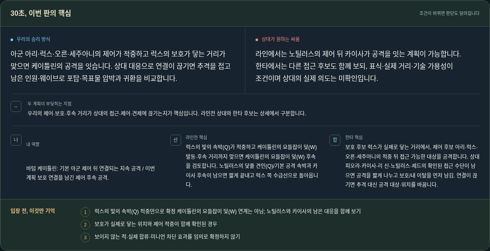
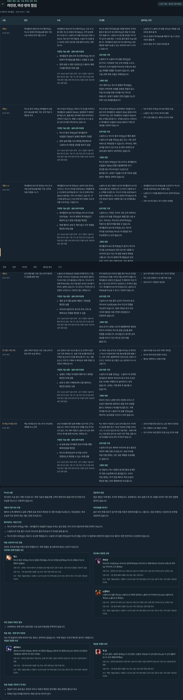
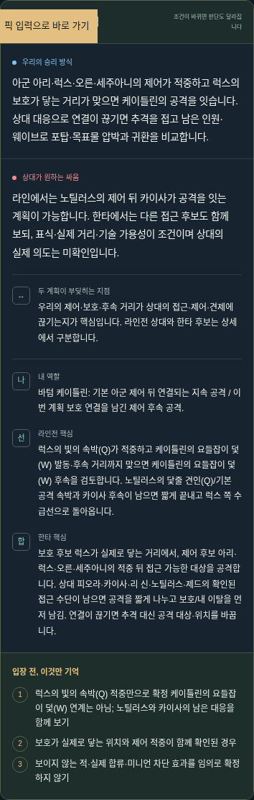

# 스킬 표시 형식 통일 — 표시 전용 변경

공식 Data Dragon 16.20.1의 보관 파일을 해시와 대조해 173챔피언·865슬롯의 이름표를 별도로 만들었다. 수집·다운로드·Gemini·Riot·유료 요청은 없다. 원본 공식 자료, loading/directions 엔진·자료, 기존 조언·승인·보류·실패·전술 원문은 변경하지 않았다.

기본 표시는 `럭스의 빛의 속박(Q)`, `케이틀린의 요들잡이 덫(W)`, `케이틀린의 90구경 투망(E)`, `케이틀린의 비장의 한 발(R)`, `케이틀린의 헤드샷(P)`이다. 로딩 요약/라인전/운영/한타/조건부 장면/지도·확대·접근성 설명과 기존 PC/프리게임/검토 큐의 표시용 복사에 적용했다. 원문 인용·편집 textarea·이력 JSON·출처 locator/URL/hash는 그대로 보존한다.

소유자+키, 소유자+공식명, 검증된 정확한 이름 목록과 명시된 필드 바인딩만 변환한다. 대표 매치업의 같은 E라도 이탈은 케이틀린, 지역 시야는 럭스에 연결했다. `동상`은 애니비아 E/브라움 Q가 충돌하므로 이름만으로 고르지 않는다. 일반 준비/반격/공포·효과인 보호막/속박·공유 계획의 덫을 특정 스킬로 추정하지 않는다. `럭스 Q(Q)`와 이미 붙은 이름(키)는 반복 적용해도 중복하지 않는다. 잘못 붙은 기존 키는 재사용 대기시간의 검증된 바인딩으로 승격하지 않는다. 소환사 주문과 아이템은 챔피언 슬롯으로 바꾸지 않는다.

독립 검토에서 일반어 오인과 owner+key 괄호 중복을 발견해 명시 RED→수정→GREEN했다. 원문 로그는 skill-display-red.log/skill-review-red.log에 보존했다. 뒤늦게 발견한 대표 요약의 덫·레벨3~5의 지정 보호막·첫 구매 행의 닻 약칭도 해당 조합/행/필드에만 연결했다. 기존 문맥 개선의 정확한 수정 전후 로딩 요약·6구간 전술 원문·선정 이유·반례·근거 질문은 [기존 보고서](../loading-context/report.md)를 그대로 보존한다.

실제 Chromium PC/390px 로딩: ../loading/browser-20261017T054437792339Z/runner.json. 상황 연습: ../directions/browser-20261017T054237663230Z/runner.json (뒤의 resolveSlot 충돌 수정은 PC 쿨다운 전용이어서 이 화면의 완료 검증은 재사용). 새 PC 전용 Node Playwright는 실제 production PC HTML 부팅과 PC/프리게임/검토큐 렌더러를 메모리 합성 자료로 실행한다. 실제 Windows/LCU나 전략 효과를 검증한 결과는 아니다. 마지막 필수 CI에서는 변경된 표시 경로와 관련 보호 경계를 확인한다.

중간 검증의 JSON/log는 모두 유지했다. 반복 중간 PNG는 지우지 않고 비공개 실행 작업공간에 바이트 그대로 보존했으며 위치/해시는 intermediate-screen-retention.json에 기록했다. 최신 PC·모바일 공개용 화면은 저장소에 남겼다.

PR55는 main75a4543에 정상 병합됐고 필수3개·병합후3개 성공을 확인했다(context-pr55-final.json). 마지막 pregame 개별 상태가 일시적으로 지연됐으나 성공 전에는 병합하지 않았다. 이번 추가 표시 변경의 CI/병합/공개게시 성공은 이 사전 기록에서 예측하지 않으며 실제 결과는 공통 실행 claim과 후속 게시 영수증으로 구분한다.

GitHub CLI는 이후 401을 반환했다. 실행 환경 진단에서 현재 설정된 자격 바인딩이 없었고, 기존 GitHub 앱 연결은 정상이다. 인증 실패를 Riot/Gemini 키 만료로 기록하지 않았다. 공개 저장소의 익명 읽기와 기존 승인된 GitHub 앱 쓰기 경로로 게시를 진행한다. 비밀정보를 읽거나 로그에 남기지 않는다.

실제 코칭 N=0/정확도 null, 신규 전략 설계 가설, AUTO30/HOLD20/USER0·조언7·Frozen350, Windows BLOCKED_EXTERNAL, Oct17 VIDEO3/3·추가 호출0·기존 Oct18③→별도 검토/CI 게시→④·진단 후1/일 정책은 그대로다.

최종 공식명 순회에서 나르!/드레이븐의 리그/킨드레드의 표식처럼 이름 자체에 챔피언이 들어가는 경우와 벨베스 원문 끝 공백을 찾았다. 원문 전체 이름을 먼저 대조하고 표시용 공백만 정규화하도록 수정했다. 전체865의 이름/이름(키)/소유자명 표시 매핑과 반복 적용을 대조했으며 원본 이름은 그대로다. 추가 RED 원문은 skill-official-name-red.log에 보존했다.
