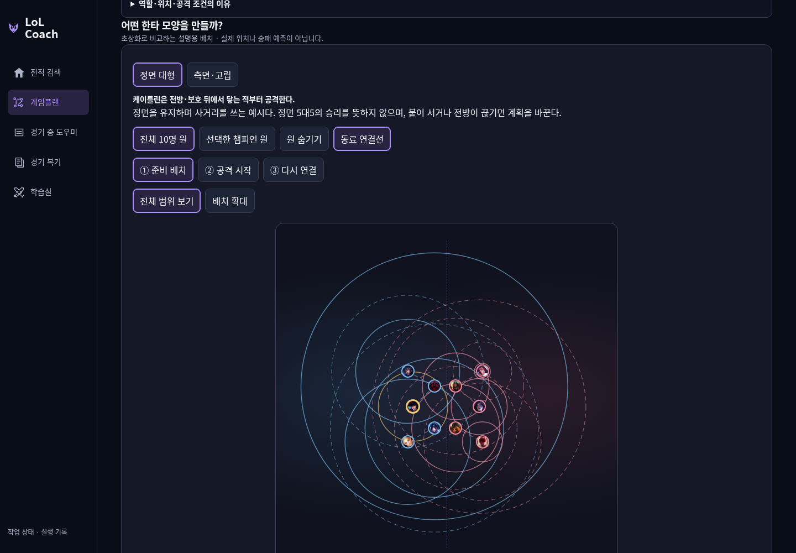
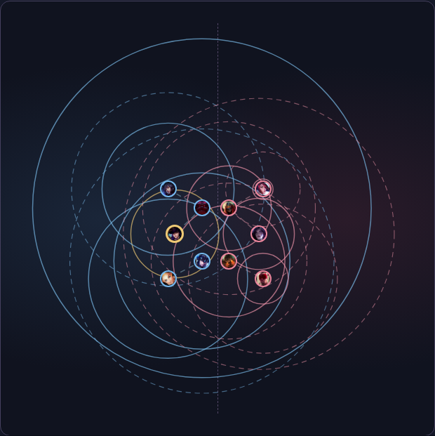
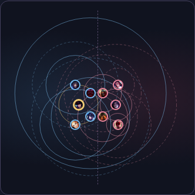
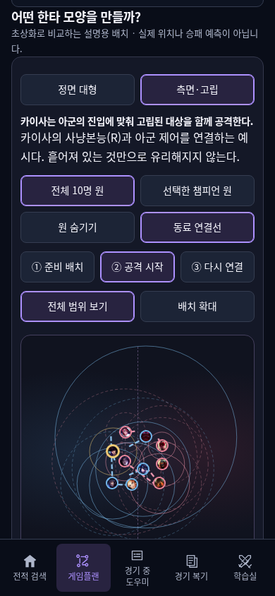
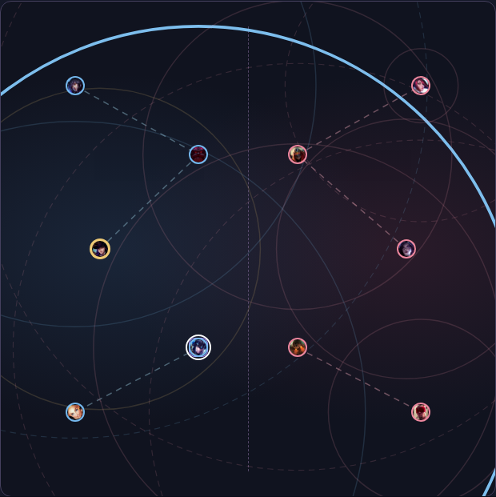

# 위협 범위 실제 공개 결과

- 웹: https://kco994553-star.github.io/lol-coach/loading.html → 케이틀린 예시 → 분석 → 한타.
- PR111 제품 main `d6583085ba6a71a7d1d32b2cc229a73ce90231a0`. 공개 artifact `fc36a774fdf77ad8d850993e4b473e4d61ad7a0a`. PR와 정확한 제품 main의 필수3개 검사 성공.
- native Pages `39126638509` 실제 build/deploy/report 성공. 변경 파일 HTTPS해시·루트·buildinfo·.nojekyll 일치, 기존 pro/riot 그대로 유지.
- 공개 PC1440×1000/모바일390×844: 새 교환 문구/중단 상세, 10명1차+7명2차, 원 전체 포함, 초상화와 원 중심 일치, 축소 초상화, 선택 강조·개별/전체/숨김, 세주아니R·제드W재사용R, 이름 선택 Enter/터치·초점·펼침 유지, 내 원 금색, 단계·확대·연결선, 기본 공격만의 회색 폴백, 입력 변경 후 낡은 결과 차단,320폭·200%가로 넘침/학습공유 확인.

새 기본 문장:
> 미니언을 먼저 잡는 흐름을 유지하면서, 상대가 막타를 치러 나오면 사거리 끝에서 짧게 견제한다.

세주아니: 현재 자리에서 빙하 감옥(R)1300 / 혹한의 맹습(Q)650로 먼저 접근한 뒤 R을 쓰는1950은 조건부 상한. 제드: R625 / W생성650→재사용 위치교환→R625의1275. 두 번째W를 추가650으로 더하지 않는다. 기술 가용·적중/표식·경로·후속·노출 비용을 따로 명시했다.

## 실제 화면

## 지원·해석 범위

10명 대표 기술 프로필, 그 외 챔피언은 기본 공격만 회색/기술 미확인. 현재 자리의 대표 수단과 비용이 드는 접근을 나눈 설계 가설이다. 공식 필드의 사실과 전술적 위험 해석을 분리했다. 전체 무기의 최대 사거리/실제 피해/완전한 위험 판정이나 승리 보장 아님. 케이틀린 Q·R/럭스 R 등 추가 위협은 상세에서 별도 확인한다. 케이틀린E 투사체를 반동 거리로 더하지 않고, 미확인 접근 원도 만들지 않았다.

관련 궁극기1레벨·모든 기술이 있는 가정의 도식이며 실시간상태를 읽지 않는다. N=0/30초 이해 미측정/Windows BLOCKED_EXTERNAL. 기존 AUTO30/HOLD20/USER0·조언7·원문·보류·실패·영상 한도 보존. 새 provider/game/video/paid 요청0.

다음: 남은 챔피언의 기전·실제 이동 거리와 조건을 확인해 프로필을 보완한다. 결과 기록만의 PR112와 최종CI는 변경 없는 기능 검증을 재사용한다.
